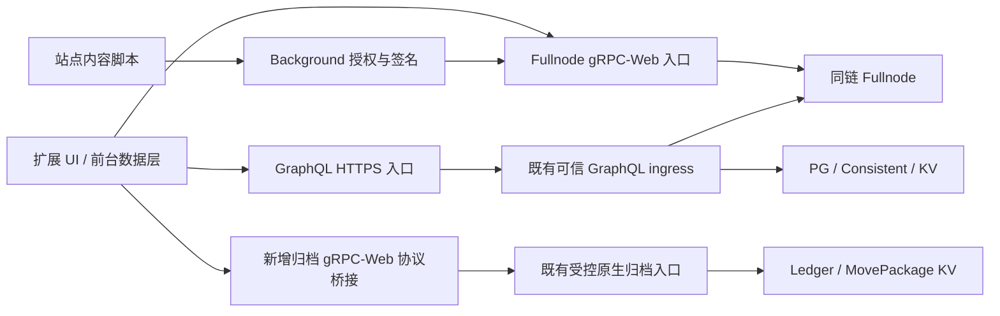

# 03 · 端点职责与浏览器接入架构

> 2026-10-12 语义核对：初始源码评估和带日期实施记录保留其原始时点；设计约束继续有效，历史“待实现／未完成”不覆盖后续验收。 当前构建与真实业务来源见 [C281](./workLog/20261012-C281-business-traffic-completion.md)，当前环境及未收口合同见 [第 14 章](./14-开发验收包安装与回归说明.md)／[剩余工作量](./leftProgress.md)。

> 2026-10-03 初始合并基线：当时的局部改动撤销与待实施状态保留为历史。正文功能合同继续有效，现行完成状态由 Task.md、totalProgress.md 和 workLog 的最新证据决定。

初版设计日期：2026-10-02。正文规定端点合同；带日期的部署观察只代表对应时点。现行 C278 钱包的四类入口与普通 Chrome 验收见钱包 C281／C280 工作日志，当前地址见合并方案第 14 章。

## 1. 官方建议与本项目路由

官方通用指南按用途区分组合读、实时 gRPC 与长期归档；SDK 迁移指南针对标准应用的具体方法优先推荐 gRPC。钱包同时包含执行、近期状态、分页索引和长期历史，应按操作选择后端。[数据访问](https://docs.sui.io/develop/accessing-data/)、[迁移指南](https://sdk.mystenlabs.com/sui/migrations/sui-2.0/json-rpc-migration)。

归档源组件提供 Ledger／MovePackage，不是一个长期保留的 Fullnode。裁剪后的旧数据需显式查询归档，不能推定 Fullnode 会自动兜底。[官方历史查询说明](https://docs.sui.io/develop/accessing-data/archival-store/using-archival-store)。

### 1.1 路由表

| 钱包操作 | 第一入口 | 允许的第二步 | 禁止或注意 |
| --- | --- | --- | --- |
| 构建交易、解析输入、选择 gas | Fullnode gRPC | 构建插件通过同一 client 补齐当前数据 | 不用归档的旧版本对象作为当前 gas 输入 |
| dry-run／交易预览 | Fullnode gRPC | 失败显示原因并停止签名；刷新输入重新预览须重新授权 | 不把 checksEnabled:false 的调试结果当正式验证 |
| 执行／首次查回执 | Fullnode gRPC | 同一摘要轮询近期 Ledger，写入 durable journal | 不因归档延迟改走另一个执行端点重发 |
| 资产页余额／币种／拥有对象 | GraphQL 同 checkpoint 快照 | 显示 snapshot 与同步状态；Fullnode 可提供独立的“当前状态”，重开查询会话 | 不在同一页面悄悄合并两个高度的余额与对象 |
| 首页当前余额／发送币种选择 | Fullnode State `ListBalances` 全分页 | 独立当前资金查询；H0前后校验，金额分量相加、币型去重、游标和预算检查；5秒同会话导航复用，写后立即失效 | 不与NFT/拥有对象组合成固定S资产证明，不回退落后索引余额；提交前仍重新读取资金并正式模拟 |
| 发送前可用币及余额 | Fullnode State gRPC | 同一次构建中重新校验版本、owner、gas | 页面 GraphQL 余额不构成最终可花费证明 |
| 精确历史交易、checkpoint、对象版本 | 归档 Ledger gRPC | GraphQL 组合展示对象类型／display／关系 | 固定选择器，返回身份与版本必须一致 |
| 最近交易详情 | Fullnode Ledger gRPC | 确认裁剪或明确历史目标且归档覆盖后，按相同 digest 查归档 | 普通 NotFound 不足以证明未提交或应归档兜底 |
| 交易／事件历史列表 | GraphQL 原生筛选；已实现账户完整历史用独立 accountHistory 扩展 | 点击摘要可转归档详情；归档 List 在明确筛选语义下使用 | 不跨入口继续使用旧 cursor；不宣称 sender 列表就是账户全部收支 |
| 动态字段／动态对象／Kiosk 展示 | GraphQL／传入 GraphQL Core 的 Kiosk 适配 | BCS 类型解析、固定快照或 SDK 多请求后核验 | Kiosk 默认网络 package 不能代替 RTD 配置 |
| 名称正向／默认反向 | GraphQL 同链 registry | 转账前重新解析与确认目标；无配置标不可用 | 不到不具备 NameService 的归档调用；不访问 Sui 公网名称注册表 |
| 验证者／质押展示 | GraphQL 组合读，读取同链系统／pool／rate | 质押操作构建和执行仍 Fullnode | SDK 无 getStakes／getValidatorsApy 直接替代，需领域组合 |
| 网络身份与保留边界 | 三入口独立查身份／覆盖 | 满足同链与 schema 要求后启用对应能力 | network:'devnet' 和名称相同不证明同链 |
| 实时刷新 | Fullnode Subscription 的前台连接（可选增强） | 断开后列表补洞；页面首次打开必有普通查询 | 不靠 background 永久长连接保持正确性 |

每个领域操作的 route 固定在策略层。允许的兜底必须有相同 chain、选择器和独立能力证明；错误不合条件时直接失败。没有无条件的“调用失败就换端点”。

## 2. Chrome 可用的协议

| 目标 | SDK／协议 | 当前状态 | 钱包接入要求 |
| --- | --- | --- | --- |
| Fullnode | RtdGrpcClient 默认 Fetch gRPC-Web | RTD `rtd-rpc-api/src/grpc/mod.rs` 有 GrpcWebLayer | 实测当前 listener 的 Web 端口、预检、请求头与流；源码支持不等于 Chrome 通过 |
| GraphQL | RtdGraphQLClient 或显式 Fetch | 已有可信 HTTPS dev 端点及原生 GraphQL 适配 | Chrome 信任本地 CA、host permission、错误与覆盖校验 |
| 归档 KV | RtdGrpcClient + 浏览器 gRPC-Web | KV 保持原生 HTTP/2 gRPC；受控协议桥接已提供浏览器入口 | C281／C280 有实际 Chrome 和恢复证据；不得将内部 native host:port 填成浏览器 URL |
| 服务端脚本 | 原生 Node gRPC transport | 用于脚本／BFF，不用于 Chrome | 不将 grpc-js、Node TLS、文件 CA 或 native messaging 带入钱包 |

SDK 源码的 `GrpcWebFetchTransport` 修正状态消息与取消错误，优先使用其导出；桥接只转换协议，不改变业务语义。[官方客户端传输说明](https://sdk.mystenlabs.com/sui/clients/grpc)。

### 2.1 建议入口结构



逻辑上三个入口必须分开配置，物理上可共享一个公开域名与 ingress，减少证书和域名维护：

```text
https://rpc.example.invalid/fullnode/<gRPC method>
https://rpc.example.invalid/graphql
https://rpc.example.invalid/archive/<gRPC method>
https://rpc.example.invalid/account/graphql   可选账户历史扩展
```

以上仅为示例，域名 `.invalid` 不可访问；实际域名、端口与证书由部署配置给出。Fullnode 与归档都包含 Ledger 方法，同域入口必须以明确前缀路由并剥离前缀，不能只按 `/rtd.rpc.v2.LedgerService` 区分它们。客户端 baseUrl 对应前缀，GraphQL URL 指向完整路径。

## 3. 归档协议桥接落地规格

优先采用开源 Envoy 的 `grpc_web` filter，前置 HTTPS／CORS／方法白名单，后端 HTTP/2 连接既有批准的原生归档入口。[Envoy gRPC-Web](https://www.envoyproxy.io/docs/envoy/latest/configuration/http/http_filters/grpc_web_filter)。也可使用已验证的同类开源桥接实现，但必须满足以下验收合同，不能写一个业务 JSON 代理冒充 gRPC。

1. 仅允许 LedgerService／MovePackageService 的已验业务方法和明确批准的反射／健康探针；禁用 Forking／管理／State／Execution／Name 及任意上游 URL 转发。
2. upstream 必须从运行时绑定取值，经过当前链身份及服务能力验证；不硬编码未经检查的 Docker 端口／service 名。
3. 浏览器请求转为原生 gRPC 后，继续经过当前认证发布门禁；不得直连内部网关或绕过已验证水位。
4. 允许 `x-rtd-min-checkpoint`，保留 `grpc-timeout`、取消及合法 SDK metadata；**剥离外部提供的 `x-rtd-visible-checkpoint` 等可信上界／内部身份头**，由受控原生入口确定公开上界。
5. 保留 gRPC code/message、trailers、流帧、水位与结束原因；HTTP 200 不是业务成功。非法／溢出最低 checkpoint 返回 InvalidArgument，不满足下界返回 Unavailable。
6. 预检和实际请求的允许头按当前 SDK 捕获验证；关注 Content-Type、x-grpc-web、x-user-agent、grpc-timeout、最低水位和协议版本相关头。以本地 SDK实际报文为准，不仅照搬官方 SDK 的品牌头。
7. 有界请求体、消息大小、并发、队列与超时；deadline 到期或 popup 关闭必须取消 upstream。限流返回可识别错误，不返回成功空页。
8. gRPC-Web **text** 首先用于 server-streaming 路径，unary 可评估 binary；须通过 SDK实际 Fetch 测试。不能仅因 binary 的单次查询通过而认定 List 流可用。
9. dev 在统一 Compose 下增加一个协议入口服务或复用同等支持的 ingress；需 health、上游就绪依赖和持久配置。无需新增一套中间件。
10. 配置进入归档服务仓库的部署与入口目录，wallet 只持有公开 URL／CA 已受信环境；生产 ingress 按相同合同部署，高可用单独实施。

桥接是本方案新增的浏览器交付工作，与已经闭合的 GAP-GRPC-MIN01 等服务项不同，不修改它们的完成状态。

### 3.1 dev 端点观察与配置处理

既有证据中 GraphQL 为 `https://127.0.0.1:39231/graphql`，原生归档为 `127.0.0.1:39197`，Fullnode dev listener 为 `127.0.0.1:39214`。它们只是 2026-10-02 的 dev 观察，不能用于启动当前 G4；发布前必须读取当前运行时绑定。

- Chrome 不能使用 Python／Node 的“指定 CA 文件”参数；本地 HTTPS 证书必须被 Chrome／系统信任，且 SAN 与实际 host 匹配。不得靠忽略证书错误做验收。
- 当前原生归档地址不能直接填进 `RtdGrpcClient.baseUrl` 宣称浏览器可用；新增协议入口单独分配端口／URL，保留 native 地址给运维脚本。
- 未开放公网主网／测试网入口时，预置网络标为未配置，不能用 SDK 默认 Sui 公网地址填空。

## 4. 客户端封装与能力隔离

```typescript
// 设计示意：profile 校验／身份握手／权限检查成功后才构造。
import { RtdGrpcClient } from 'rtd-typescript/grpc';
import { RtdGraphQLClient } from 'rtd-typescript/graphql';

const fullnode = new RtdGrpcClient({
  network: profile.sdkNetwork,
  baseUrl: profile.fullnodeGrpcWeb,
});
const graphql = new RtdGraphQLClient({
  network: profile.sdkNetwork,
  url: profile.graphqlUrl,
});
const archive = new RtdGrpcClient({
  network: profile.sdkNetwork,
  baseUrl: profile.archiveGrpcWeb,
});
```

这是客户端构造示意，非已编译代码。raw 服务在 archive 实例中存在属性，并不表示归档服务器实现了全部服务。对外只导出受限的 `ArchiveReader`（Ledger／MovePackage 方法）；Fullnode 执行能力只暴露给交易服务，避免页面误用 archive.stateService。

公共接口建议：

| 领域接口 | 输入／输出约束 |
| --- | --- |
| readPortfolio | owner、读取会话；输出统一 checkpoint／digest、币余额与覆盖状态 |
| readOwnedAssets | owner／筛选／会话 cursor；全部页通过后更新持有集合 |
| readHistoryPage | owner、范围／筛选、独立 cursor；输出证据范围与完整性等级 |
| readHistoricalTransaction | digest、链身份、可选 min；输出新 SDK 联合结果与来源 |
| resolveRecipient | 名称、链、registry revision；输出 address 与解析来源 |
| prepareAndPreview / execute / recover | 在 05 中定义；不接受页面提供任意执行 URL |

这些是钱包领域边界，HTTP／gRPC 仍由官方 fork SDK 处理。不要实现一个仿造旧 `RtdClient` 的万能兼容层。

## 5. 故障与成本控制

| 故障 | 钱包动作 |
| --- | --- |
| Fullnode 不可用 | 历史页可保持；发送／模拟禁用；已提交 journal 显示待确认，不换入口执行 |
| GraphQL 落后或部分管线不可用 | 按字段 availableRange 判定同步中，保留上一成功完整快照并标时间；不归零 |
| 归档不可用 | 当前操作仍可用；长期详情报暂不可用；不把历史回执当不存在 |
| 三入口 chainId 不同 | 摘除不一致入口；内置完整网络不就绪，禁止执行；自定义降级要明确确认与禁用相应功能 |
| 名称 registry 缺失 | 普通地址发送保留；名称输入报不支持；不将字符串当地址发送 |
| 协议版本／schema 不兼容 | 对应能力禁用并上报版本；禁止忽略解码错误 |

查询去重由SDK cache、TanStack和钱包请求队列共同负责，但按完整网络绑定、owner、固定快照及操作参数隔离；仅复用仍有效的结果或发出前同一批请求，写后/切网/撤权立即失效。每个页面不设置统一查询次数上限，必须读取的页与读后校验不能为压低次数而跳过。并行读取限制建议 4 个、列表页按序，详情批量 10–20 个且不跨独立请求无限并发；实际限额以服务配置校准。执行不使用自动重试，读错误按有界退避处理。

观测按端点角色／操作／错误码／耗时／重试／水位落后记录，业务日志默认不记录私钥、助记词、签名、完整交易参数、用户地址／origin 明文。生产无需为三入口新增业务数据库或钱包身份系统，维持现有服务部署职责。

### 5.1 统一错误合同

| 原始结果 | 领域分类／展示 | 自动动作 |
| --- | --- | --- |
| Cancelled／AbortError | 会话已取消；不显示失败余额 | 读请求结束；dispatch 后仍是 pending |
| DeadlineExceeded／TimeoutError／Unavailable | 暂不可用／同步中，保留最近成功快照 | 读可有界退避；提交不重发 |
| ResourceExhausted | 请求预算或并发超限 | 读降低并发并退避；不把服务故障改为空页 |
| InvalidArgument／错误 cursor／输入校验失败 | 请求不合法，定位配置或程序问题 | 不自动重试同请求 |
| Unauthenticated／PermissionDenied | 未授权或入口策略拒绝 | 重新授权／修正配置，禁止切内部直连 |
| Unimplemented | 当前端点无此能力或协议不匹配 | 禁用对应能力；不换回 JSON-RPC |
| NotFound／ObjectError | 按对象／版本／已知裁剪范围解释缺失 | 仅历史合同允许时查归档；不能否定未知交易已提交 |
| GraphQL errors 或关键字段缺失 | 组合读不完整／依赖不可用 | 整个领域快照不提交；非关键展示字段可明示缺失 |
| FailedTransaction | 已入链的执行失败 | 保存终结回执；与传输错误严格分开 |
| identity／snapshot／coverage不一致 | 错链或读取合同不成立 | 停止接纳数据和可能混链的执行，重新绑定 |

错误对象保留端点角色、operation、错误码、retryable、traceId和可公开message；不向页面透出内部服务凭据。公共服务查询本身是只读，错误处理也不能触发重建、重置水位或修改合约状态。

## 当前 Fullnode 入口探测的实施边界（2026-10-03）

钱包限制检查使用当前 NetworkProfile.fullnodeGrpcWeb 的 `LedgerService/GetServiceInfo`，不再向固定 testnet JSON-RPC 发请求。只有完整 H0 匹配且 checkpointHeight 为合法 u64 的成功 gRPC 响应才可判 accessible；HTTP200本身不是成功。HTTP403且正文严格匹配现有 `error code: 1020` 才保留入口政策 restricted 映射，其它网络／HTTP／gRPC失败保持未知，不能推断地域限制或解除既有限制。

探测独立于 GraphQL 资产准入，绑定 profile／readSession，10秒预算、取消和迟到会话屏障；禁止自动重定向和发送凭据，正文判定有长度上限。限制页只在明确accessible时返回，错误／未配置／新会话不得靠默认false清除既有状态。该探测不证明archive覆盖、索引同步、包部署或可签名。实现与13项受控协议／React验证已记录在钱包合并目录 `workLog/20261003-RPC-24-entry-access.md`，真实环境仍另验。


### gRPC-Web实现进展（2026-10-03）

归档deploy/grpc-web生成Envoy v3配置，显式TLS/mTLS与已批准发布入口绑定、逐方法exact path、可信头剥离、最低水位规范u64及预算。真实Envoy v1.39.1配置加载、6项渲染守卫及合成上游8项协议探测通过；实际SDK binary unary和text双帧trailers可用。Lua清理无关内部头需保留已匹配路由缓存，避免prefix rewrite后重新匹配404。配置生成不等于上游已获批准，合成上游不等于真实发布门禁；现未将桥接直连裸Ledger，也未宣称Chrome／取消／错误流验收完成。详见钱包workLog/20261003-ENV-grpc-web-protocol.md及归档deploy/grpc-web/README.md。


### 取消与deadline协议证据补充（2026-10-03）

合成mTLS入口的真实Envoy／SDK探测扩至14项，新增客户端取消／deadline的native上游reset、流中错误trailers及超大请求拒绝。显式AbortSignal.timeout可归类DeadlineExceeded；仅grpc-timeout触发Envoy对已开始流的强制截断时，SDK实际为Internal/terminated，不能伪造服务端DeadlineExceeded回执。两者均为失败，分页消费者必须丢弃未完整结束的前缀。真实发布门禁与Chrome仍待验，详情见钱包workLog/20261003-ENV-grpc-web-cancellation.md。


### 发布门禁吞吐与完整性（2026-10-04）

MinIO传输按进程／端点／CA内容／身份复用连接池，不缓存发布结论或对象内容，完整前缀、固定版本、复制状态和SHA核验保持。证书变更重新构建连接，非法信任材料拒绝。guard定向部署与适配器源码重新绑定已完成；主机32测试及镜像24测试通过。12次真实请求中位耗时约0.698秒降至0.515秒，实际资产共同快照87061读取成功，但consistent消费约1.89 checkpoint/s低于链写入约4.5–4.6，积压尚未消除。额外适配器探测因预算占满返回503，不算成功。完整证据在钱包合并目录 workLog/20261004-guard-transport-reuse.md；不代表非空资产、完整历史或可试用验收通过。


### 发布前缀查询的物理优化（2026-10-04）

指定dev链新增H0／bucket限定的部分覆盖索引，键sequence_number并包含transactions。完整前缀SQL及所有发布、版本、SHA核验保持，未缓存认证结果；并发建索引且保留原索引。当前真实绑定参数计划自动采用Index Only Scan，固定前缀结果不变，查询块数10670降至1028。实际门禁12次及准入通过，但整体消费尚未追平。未来预备语句通用计划或数据库连接池变化须重验部分索引适用性。操作与证据见钱包合并目录workLog/20261004-prefix-index.md，不构成完整试用验收。


### 2026-10-04：追赶容量及启动绑定

在现有三消费者运行时，额外1／2并发各24次guard只读请求均成功，固定checkpoint内容SHA一致，准入检查通过；探针吞吐约2.53／4.20请求/s，不等同持续消费者吞吐。adapter四permit和2／1／1消费预算未改。

当前debug源码／二进制与实际进程身份核验通过；最低水位indexer162777、consistent101651、KV101658仍未覆盖PersonalKiosk203097。query／KV启动binding确认残留visibility传输升级前的adapter config摘要；当前进程继续消费，但重启前需依据已保存的升级证据，受控同步binding和KV manifest。不得绕过来源校验、直接提高预算或重建数据库来消除差异。本轮仅观察，未重启消费者／改写数据。


### 2026-10-04：消费者启动摘要已受控同步

visibility-only 升级造成的 query／KV 启动适配器摘要滞后现已修复。通过旧备份 manifest、已验证覆盖层／测试日志、原镜像模块、当前 debug 来源和四进程身份核对后，仅更新两份 binding 的适配器摘要及 KV manifest 的 binding 摘要，私有原文件和操作阶段保留。

独立核验原启动器的完整绑定与不可变配置检查通过；当前 query／KV debug 来源和适配器摘要均匹配。没有停止／重启进程，也没有改变并发或数据。这是启动绑定恢复，不是扩容／追平验收；后续仍须按受控流程调整总预算并验证水位。


### 2026-10-04：身份核验与可读性边界

NET-03客户端隔离／重复身份核验已完成：6文件80项测试及实际三入口两轮6次只读查询通过，完整H0一致。原始客户端不暴露给页面；探针只返回身份报告，能力／覆盖／package需独立验证。实测中身份查询成功与扩容恢复期间资产共同快照不可读同时存在，不能把identity-verified等同ready或trial_ready。Node显式开发CA证据不能替代Chrome原生权限和系统信任。详见合并目录workLog/20261004-NET-03-completion.md。


### 2026-10-04：六名额容量升级与恢复窗口

适配器明确配置6个名额，三个消费者预算2／2／2，guard仍8；当前源码debug来源和原启动器绑定核验后保留数据受控停启。升级6项测试、原启动器及guard12次／准入通过。KV bitmap按持久桶起点重放，consistent重启下界已为104096，而共同上界暂为104095，实际资产读取被正确拒绝。不能把进程存活／身份探测成功当资产恢复；以合并目录workLog/20261004-capacity-upgrade.md后续真实探针为准。


### 2026-10-04：六名额升级后资产读取已恢复

前述共同快照空窗在KV桶重放越过恢复边界后结束：18:31:48实际钱包reader于S104195读到13对象，随后真实Chrome于S104409的对象列表／Kiosk空详情及锁定／整浏览器重启通过，0模拟／0提交。三消费者22／4／14管线最低174807／111246／104334，当前debug与adapter绑定匹配。此次维护从启动到首次成功约26分钟，失败日志保留；不是追平PersonalKiosk203097或完整试用验收。最终证据见合并目录workLog/20261004-capacity-upgrade.md及20261004-capacity-completion.json。

### 2026-10-04：保留链协议覆盖调整的失败边界

Sui 固定源码 commit `c860146823abcedef45a1b5a9c766920be98a29c` 的 [本地启动说明](https://github.com/MystenLabs/sui/blob/c860146823abcedef45a1b5a9c766920be98a29c/crates/sui/src/sui_commands.rs) 支持环境变量覆盖 checkpoint 最小间隔，要求所有节点配置一致且限于本地网络；[CheckpointQueue](https://github.com/MystenLabs/sui/blob/c860146823abcedef45a1b5a9c766920be98a29c/crates/sui-core/src/consensus_handler.rs) 以该间隔决定待处理交易如何组成 checkpoint。前者不能证明既有链中途改参后能安全重放。当前 RTD 的原生 GetEpoch／ProtocolConfig 使用 `get_for_version_if_supported`，返回协议版本声明值，不反映启动环境覆盖，不能凭这个接口认定覆盖已生效。四份官方原文与摘要保留在钱包合并目录 `evidence/official/20261004-checkpoint-interval`。

本次在同一 debug 产物／genesis／YAML／数据库下尝试把间隔改为1000ms，重放 checkpoint **424107** 时与此前本地计算摘要不同，触发 `checkpoints/mod.rs` 的保护退出；调整没有成功。最后持久 checkpoint 文件为424106，424107没有可用认证文件。恢复原启动环境后，Fullnode还能读取原H0、三个既有成功交易和完全相同的余额，但15秒内链头保持424106，启动日志存在 fork recovery 阻止记录，runtime **ready=false**。25项运维守卫测试通过与实际ready拒绝证据只证明对应守卫，不是链恢复通过。

`link-u-smart-contract/all-in-one-deploy/localDeploy/tune_wallet_checkpoint_interval.py` 的变更入口已禁用；保留链冷启动拒绝缺乏创建时重放证明的非默认协议覆盖，默认恢复会剥离继承的所有覆盖环境项。原YAML／genesis与已执行交易／journal保留，未清分叉标记、未重建链、未重发交易、未重启消费者。后续必须先证明原 checkpoint／共识重放的正确恢复条件，继续使用指定 RTD 当前源码的debug产物；不能以旧摘要日志充当 quorum certificate，也不能为完成试用而绕过分叉保护。

消费者仍在处理已保存的 checkpoint：22:46:28观察 indexer22管线最低223275、consistent4管线159806、KV14管线151723；debug及adapter绑定匹配。钱包生产reader在S151755读取原账户13对象。这是有限窗口读取，不是链头推进、WMIG／PersonalKiosk追平或完整可试用验收。完整失败、恢复和readiness拒绝证据见钱包合并目录 [操作日志](/Users/changzechuan/WenchuanProjects/RTD-Blockchain/rtd-apps/wallet/migrationToGRpcOrGraphQLDoc/workLog/20261004-checkpoint-interval.md)。

### 2026-10-04：保留原计算摘要的受控重放恢复

实际只读secondary检查确认424107没有认证证书，原摘要及self-divergence marker仍在；从genesis验证三个epoch委员会转换，424106证书／内容／前驱和共识中的原签名通过。最新4096块中没找到424107签名，只能作为该范围观察。

[Sui节点源码](https://github.com/MystenLabs/sui/blob/c860146823abcedef45a1b5a9c766920be98a29c/crates/sui-node/src/lib.rs)的显式checkpoint override在指定摘要等于原存储摘要时保留计算记录；[builder](https://github.com/MystenLabs/sui/blob/c860146823abcedef45a1b5a9c766920be98a29c/crates/sui-core/src/checkpoints/mod.rs)仍在保存及签名前核验重放摘要，不一致则再次fatal。本次限制原环境／原摘要／原H0／单验证者、无交易分叉和认证冲突，并保留原计算记录，进行一次受控重放；不能选用不同摘要删除记录或将旧计算日志声明为quorum依据。

实际424107获得与原记录逐字一致的认证证书，签名／contents／前驱均通过且无新分叉。随后已撤回临时恢复字段，全部原YAML／genesis／数据库／journal保留；三笔原交易未重发，消费者未重启。15.082秒原生采样424269→424338，三笔成功回执和余额与调整前一致、0模拟0广播；Fullnode／faucet端口及PID3922身份检查通过，runtime.ready=true。钱包trial_ready仍为false，索引追平和display超时继续单独验收。详情见合并目录workLog/20261004-original-summary-recovery.md。

### 2026-10-05：最新 debug 替换与共同 S 恢复门槛

对象版本 SQL 修复后，所需八个 debug 二进制与原生证书 helper 均从指定当前 rtd 源码重新编译。source／query三服务／KV两服务按原身份及参数受控替换，原数据、发布租约、genesis、H0与交易journal保持。KV mTLS启动遗漏导致的退出已修复为复用原环境构造函数；running不能替代健康。核心 CLI 已编译但运行进程尚未切换，整个dev最新产物切换仍有待办。

重启后KV可读S低于consistent窗口下界，导致 GraphQL WatermarkTask 更新失败并维持空能力状态；FEATURE_UNAVAILABLE不能当成资产为空或已就绪。实际S168643低于176712–178627，钱包 admission reason=partial，旧S163619集合亦被拒绝。优先恢复全部管线与共同S，再核验完整display／NFT及Chrome，不绕过覆盖。见[实际记录](/Users/changzechuan/WenchuanProjects/RTD-Blockchain/rtd-apps/wallet/migrationToGRpcOrGraphQLDoc/workLog/20261005-query-range-recovery.md)。

### 2026-10-05：核心 CLI 最新 debug 切换完成与持久化范围

本批通过指定合约仓库受控脚本，将原CLI3922替换为当前源码debug CLI21240；停止守卫中止后，只在原PID确实消失、端口空闲、无启动记录且原源码／配置／数据绑定保持时单次恢复。同H0、原三笔回执／余额逐项一致、15.042秒438627→438698，0模拟0广播，原YAML／数据库／genesis／journal和消费者保持；Fullnode／faucet身份及当前源码／二进制再次核验后runtime.ready=true。33项恢复／切换守卫通过。此前本日“CLI尚待切换”由本批实际证据更新。

KV14条及consistent4条持久化水位已可核实，不能以stdout只见1条推导其余停顿。00:39:50原生consistent范围176712–184248、GraphQL Ledger171325，仍差5387；原retention下界在本次启动后保持，消费者继续推进。共同S必须由生产reader接纳及同链证明，核心ready不等于钱包trial_ready；48/98保持。权威关闭路径、范围依据、失败及全部证明见[本批日志](/Users/changzechuan/WenchuanProjects/RTD-Blockchain/rtd-apps/wallet/migrationToGRpcOrGraphQLDoc/workLog/20261005-core-debug-current.md)。

### 2026-10-05：授权监听队列和资产只读恢复

共同窗口已由生产WalletAssetReader实际接纳S176808，13对象五组字段通过。随后公开查询出现的下游503，经私有日志脱敏投影确定63次超时均处于连接授权监听器阶段；Python3.9默认TCP队列5的8路/live测试仅24/32成功，不涉及发布／SQL检查。依据[Python官方队列语义](https://docs.python.org/3.9/library/socketserver.html#socketserver.TCPServer.request_queue_size)，指定合约仓库启动器将连接队列改为32；检查8和请求32预算、逐请求新鲜fail-closed及原配置／manifest保持。队列不是增加发布检查或适配器吞吐配额。

保存原源码／绑定／进程记录并核验后，只替换该Python监听器86054→11462；六个原生消费者身份保持，核心／genesis／数据库／journal未重启或重建。5项真实内核队列及停止守卫通过；同测试32/32、扩展256/256、Docker TCP24/24成功，合法三surface204、unknown403。固定S原生555ms与公开1027ms均通过；OriginByte两账户S182969共123请求，完整读取／新鲜对象比对及两条未签名转出路由检查通过、0模拟0广播。

不包含实际NFT签名广播、Chrome非空NFT或v1历史模板验收。早先失败证据保持，完整后续结果以[本批日志](/Users/changzechuan/WenchuanProjects/RTD-Blockchain/rtd-apps/wallet/migrationToGRpcOrGraphQLDoc/workLog/20261005-current-assets-window.md)为准。48/98保持、trial_ready=false。

后续稳定性检查修正：本机监听队列缺陷已消除，但Docker入口仍有39592建连超时；当前Chrome在资产查询阶段TimeoutError，0模拟0广播，未进入页面验收。完整NFT单次通过保持，不能把队列测试通过等同公开入口持续稳定。本批正在进行隔离建连预算对照，详情见同一日志。

### 2026-10-05：Local构建配置与Chrome失败原因修正

新增只读流量诊断证明上述Chrome超时期间0条GraphQL请求；原2eaddb／ef15ecc产物均缺审核Local registry，因此不能把该失败归因于入口503。已保留原产物，以现有profile03 revision2和显式API_ENV／WALLET_NETWORK_PROFILES重建开发产物，应用源码摘要保持。UI SHA90c2d492671d620e5ab4fee79309bc83d815adbec100a5834e768b8c2b064773，后台SHA05b4e235093f20812ad0385db7db9af9dfd19f890608ef5987b0038fecab1f24；AST逐JSON字面量证明双方bundle完整registry一致，4项拒绝／解析测试、四入口provider与39方法闭包通过。Local Chrome测试启动前强制该校验，避免未配置产物误入实链验收；当前Chrome结果以同一本批日志为准。

独立临时nginx对照2秒／5秒各40个授权请求全部204，未复现原入口残余超时；对照容器已移除，生产超时没有调整。TCP残余问题继续独立排查，不能把增大等待预算当作已证明修复。

### 2026-10-05：切网缓存清除后的就绪门禁与当前Chrome恢复

切网清空QueryClient后，存储迁移hook此前在ready时永久停用轮询，缓存消失又不核验，主页面因缺就绪状态而空白。真实React／QueryClient回归先复现该失败；现按ready状态同步enabled，缺缓存重新核验，保留切网清理／会话隔离与原准入。14项定向、132文件1418项、完整tsc和显式profile03开发构建／双入口AST／四入口provider／39方法静态闭包通过。

最新UI SHA c446dd353574351169480316ddeaf521340f644e0bbe347da3e257564cc59acd，后台SHA05b4e235093f20812ad0385db7db9af9dfd19f890608ef5987b0038fecab1f24。真实Chrome于S189657通过余额读取、10非视觉对象及链接、Kiosk卡片／空详情、密码／锁定／整浏览器重启，0模拟0广播，实际worker与当前磁盘产物匹配。全部此前未配置、空白、测试收集失败及旧产物保持，见[修复与证据](/Users/changzechuan/WenchuanProjects/RTD-Blockchain/rtd-apps/wallet/migrationToGRpcOrGraphQLDoc/workLog/20261005-storage-migration-cache.md)。

采用compiled Local及精确开发SPKI例外，正常CA、自定义权限、直接NFT display／隐藏、非空Kiosk页面和实际NFT转出未验。OriginByte生产两账户读取及未签名路由有独立证据，不能替代这些页面／执行验收。Docker原入口间歇建连、Display历史D2–D6及剩余完整门槛继续推进；48/98、trial_ready=false保持。

### 2026-10-05：Display v1历史索引与独立连续覆盖的编码状态

RTD新增hist_displays与每checkpoint的hist_display_checkpoints，保留类型BCS、完整链上位置、交易digest、Display ID、0–65535发布版本和原VersionUpdated事件。DisplayCreated或字段编辑不能产生发布模板；不折叠同checkpoint多事件。独立hist_display_coverage绑定H0／sourceId／generation，从-1经genesis连续前进；事务同时提交marker、全部事件、coverage及框架watermark。重放必须marker和完整事件集合逐字节一致，冲突／缺口不推进；数据库禁止历史改写、删除与truncate，coverage禁止身份变化、回退、缺前驱／checkpoint／事件。三个新表纳入Alt epoch提交门禁，promotion等待已准入事务结束，随后旧epoch写入被拒绝。该证明仅涉及Alt PG，不代替MinIO／HBase或多节点验收。

整个索引器库66项通过；新增19项包含17项历史测试（12项实际PostgreSQL）及2项配置测试，sourceUnchanged=true。GraphQL兼容编译、6项合约仓库回放准备守卫与格式／diff检查通过。回放准备只生成有界历史配置与保留原管线的恢复配置，要求认证来源和独占writer，未实际替换服务或执行认证checkpoint回放。新历史表未部署；D2仍有真实回放待办，D3的(type,S)loader／scope／v1-v2优先与basis、D4准入以及D5-D6完整认证和页面回归继续推进。完整debug重编译及运行绑定更新必须先于下一次新源码部署，不能把旧构建证明改成当前源码已通过。48/98、trial_ready=false保持。

详细源码、失败保留和验证范围见[历史索引实现日志](/Users/changzechuan/WenchuanProjects/RTD-Blockchain/rtd-apps/wallet/migrationToGRpcOrGraphQLDoc/workLog/20261005-display-history-indexer.md)。

## 2026-10-05：Display历史读取与GraphQL模板basis

D3已接入HistoricalDisplayKey(type,S)：参数化UNNEST／LEFT LATERAL以完整checkpoint／transaction／event位置取cp≤S的最后发布事件。一次MVCC查询同时检查从genesis连续覆盖、hist管线自己的watermark／H0／genesis及S marker／端点、sourceId／generation；缺历史失败，已覆盖且无发布事件才返回null。BCS模板ID和u16发布版本必须与存储元数据一致；重复键及同类型多S按ordinal处理。旧sum_displays保持。

GraphQL必须有indexed检查点S，v1读历史，v2同S registry优先，仅解除继承root界限；核对v2对象ID、具体类型、对象版本／digest及来源cp≤S。存在模板却缺资产layout会失败，execution／stream无S不能借当前模板。Display.basis为DisplayV1Basis／DisplayV2Basis union：v1含snapshotCheckpoint、objectType、templateId、publishedVersion、sourceCheckpoint／Digest、transactionDigest、checkpointTransactionIndex、eventIndex、eventBcsSha256及historyCoverage；v2含S／类型／模板ID、objectVersion／Digest、sourceCheckpoint、previousTransactionDigest、contentsBcsSha256及historyCoverage。historyCoverage含H0、sourceId、generation、first／lastCheckpoint及lastCheckpointDigest。digest出参checked 32字节后以规范Base58 String输出；UInt53显式限制JavaScript安全整数。SHA仅为BCS内容身份，coverage为认证来源索引绑定，不是可携带密码学证明。

默认features下Reader全库36项、GraphQL全库247项通过（新增7／10项，其中6／2项实际PG函数），两个证明sourceUnchanged=true且与本批当前源码一致。实际1025事件、7数组请求的热点／稀有／缺失／重复键Loader为15.720208ms（含连接／解码），同参数EXPLAIN ANALYZE SQL为0.466ms、type_position索引loops=7；仅为独立TempDb规模，不是生产SLA。SDL及新增27字段的范围映射snapshot已核对；初次Digest输入scalar出参panic和snapshot失败已修正并保留证据。

D3编码与本批库回归完成；D4的服务能力／availableRange／钱包basis准入，D2真实认证回放及D5–D6完整认证、中断恢复、最新八个debug产物受控部署和钱包／Chrome仍待推进。新代码未部署，不能先切换查询服务而跳过历史连续回放；不得以本批库回归代替产品验收。48/98、trial_ready=false保持。详见[源码、失败修复和最终证明](/Users/changzechuan/WenchuanProjects/RTD-Blockchain/rtd-apps/wallet/migrationToGRpcOrGraphQLDoc/workLog/20261005-display-history-reader.md)。

## 2026-10-05：Display历史能力与钱包basis准入

D4已接入ServiceConfig.displayHistory（apiVersion=1、V1/V2及连续coverage）。coverage在H0／sourceId／历史generation／0至hi端点之外，增加snapshotCheckpoint和snapshotCheckpointDigest；新的CoverageKey(S)以NULL类型边界关闭事件查找，复用同MVCC的独立历史watermark与marker验证。网络profile generation不等于历史generation。

MoveValue.display、Display.output／errors／basis及v1/v2 basis字段的availableRange依赖hist_displays、obj_versions、consistent、ledger_grpc；能力／coverage字段依赖hist_displays。缓存管线缺失或实际历史不覆盖scope S时直接失败，不使用默认空范围。SDL和依赖快照已同步。

钱包在admission检查H0与来源，pin／每页read／末验在固定checkpoint(S).query内校验同sourceId／历史generation及S摘要；覆盖上界可正常前进。非空Display要求规范类型／模板ID、source≤S、匹配历史来源与S marker的basis。v1按u16发布版本、交易／事件位置和原事件SHA核对；v2核对0xd registry的DisplayKey<T>派生ID和对象版本／摘要、前一交易及contents SHA。SHA只表示内容身份，能力不是可携带证书；null只有已准入完整覆盖才有效。partial、缺basis、来源变化、未来模板、取消／超时／旧session／分页预算耗尽均拒绝完整资产结果。

[Sui概述](https://docs.sui.io/develop/objects/display/display-overview)及[固定官方registry源码](https://github.com/MystenLabs/sui/blob/c860146823abcedef45a1b5a9c766920be98a29c/crates/sui-types/src/display_registry.rs)核对v2确定性派生语义；本批displayHistory／历史coverage／basis是RTD扩展，未冒充上游标准API。钱包完整请求按本地RTD SDL校验，公共投影另按SDK与保存的官方Sui SDL校验。

最终Reader38项、GraphQL249项均sourceUnchanged=true并绑定同一当前源码；D4新增4项实际PG测试函数。钱包133文件1463项、本批新增45项，完整tsc、显式reviewed Local开发构建及双入口AST、四入口39方法静态闭包通过。旧dist保存，新历史服务／认证回放／新版Chrome尚未部署或验收；D5–D6及父任务仍待完成，48/98、trial_ready=false保持。详见[本批合同、失败记录与证明](/Users/changzechuan/WenchuanProjects/RTD-Blockchain/rtd-apps/wallet/migrationToGRpcOrGraphQLDoc/workLog/20261005-display-history-admission.md)。

## 2026-10-05：Display最新debug部署与认证历史回放

D2–D4的八目标及三个publication辅助程序已由指定rtd当前源码在独立debug cache成功构建；完整索引器66项与Reader38／GraphQL249项回归的源码identity相同。仅CLI／indexer／GraphQL三个artifact改变，其余五个服务文件及三个helper字节不变。指定link-u-smart-contract的独立安装／停止恢复脚本保留原数据、genesis、YAML、交易journal与全部旧artifact，按原子复制和独立installation证据核验默认target实际文件，不将隔离构建的deployedArtifactsReplaced=false改写成已部署。只替换三个变化产物的进程；四个字节相同消费者、一致性快照、认证adapter和发布进程保留。旧reader单文件reload范围保持严格，未用于这次广泛修订。

真实最新来源守卫已接受安装文件；三个历史表及不变性／连续覆盖／epoch触发器安装，原22条管线保留。核心在旧durable cursor和共识恢复结束后通过487696→487767及原三笔回执／余额／H0和listener所有权证明，ready=true只对应核心。首次停止身份过渡、错误binding字段、RPC尚未监听和未推进采样均保留为失败；停止后恢复只接受原PID与同命令竞争者已消失、没有复制或新launch的状态，不重复发信号、强杀或交易广播。

认证history-only有界回放从checkpoint0真实执行，准备上界386503，复用原indexer两个读取名额，不增加cohort、不从当前sum_displays制造历史。监督进程记录实际child exitCode并持有lifecycle锁；同一只读TLS事务核对genesis／sourceId／generation、readerLo0、marker连续全集／端点和hist watermark，准确覆盖准备上界、退出0、源码／产物不变且旧22条水位原样后才恢复原22条加hist live。首次覆盖0–196／197marker是观察，尚无终态退出码；完整认证、生产同S Display／直接NFT／OriginByte和新版Chrome仍未验收。钱包Task48/98、trial_ready=false；核心和schema安装不能折算为这些父任务完成。


## 2026-10-05：认证前缀辅助索引与历史回放吞吐

指定dev的PG17.10已安装独立辅助前缀表，保留原checkpoint／chain数据。每行直接外键关联原(scope,sequence,transactions)，前驱外键关联前一行(scope,sequence,total)，行内算术约束从genesis归纳证明连续0..S及精确累计交易数。跨行事实不由CHECK函数推测。[PG17约束](https://www.postgresql.org/docs/17/ddl-constraints.html)；AFTER INSERT与原插入同事务、固定受信search_path和受限SECURITY DEFINER生成下一行。[PG17触发器](https://www.postgresql.org/docs/17/trigger-definition.html)／[函数安全](https://www.postgresql.org/docs/17/sql-createfunction.html)

安装事务逐行SHA核对431328条原checkpoint及全部chain状态前后一致；辅助表逐scope与完整原聚合一致，后续新增checkpoint也必须经过立即外键和原子触发器。读者每次持有两表ACCESS SHARE锁、开启只读REPEATABLE READ，检查冻结catalog摘要，约束／触发器／函数／权限／对象身份变化即拒绝；关键catalog行xmin使禁用后恢复仍不能复用旧证明。固定版本GET、源及副本latest HEAD／复制状态／SHA和前后末验保持，未缓存positive admission。数据库superuser仍属于受信运维边界。

guard采用单独证明的镜像overlay，仅替换ledger_snapshot函数体调用prefix_ledger，其他原函数的AST逐项相同；adapter冻结的三个主机文件及manifest保持。辅助DDL与镜像安装分别有独立证据，不将新增辅助schema冒充纯镜像部署。真实独立PG26测试及12组新旧守卫差分场景、镜像24项／主机32项TLS守卫、部署7项单元测试通过。候选镜像实际读取0／100／386503固定版本并拒绝未来与非法路径；运行mTLS准入与固定SHA通过。首次切换后监听尚未启动导致URLError，保留失败，随后仅只读终验通过，没有重做切换或重启消费者。

并发回放中的12次相同checkpoint读数，中位约0.486秒降至0.302秒，全部200且固定SHA相同；包含运维身份检查及请求开销，仅为本机测量。连续回放仍使用原PID66145、原H0／sourceId／generation、0起点和386503上界，原22管线水位保持；部分覆盖不等于终态或Chrome验收。guard8、adapter6、三个消费者各2名额保持。原全扫描算法及旧镜像保留；完整认证回放／恢复live／共同资产S与新版Chrome仍待。此项不提供多节点旧writer提交fencing证明。设计、实际状态与逐次证据见合并目录workLog/20261005-publication-prefix-index-design.md及workLog/20261005-publication-prefix-index.md。


### 2026-10-06：桥接传输与取消的实测边界

当前固定Envoy／同renderer的30项协议检查覆盖binary／text unary与server stream、header或body trailer错误、可信头剥离、min与deadline、不延长调用者预算、实际原生mTLS reset、CORS、过大请求和32个上游并发限制。真实Chrome在实际loopback HTTPS文档中完成允许／拒绝origin及AbortSignal／page关闭至原生RST；临时origin和精确SPKI均明确，未改运行白名单、未禁用CORS，不作为正常CA／公网到私网权限证据。

原同链认证入口另有20次实际只读成功：完整末status、固定原生帧与摘要、已观察min保持genesis历史selector、不可满足最大min返回Unavailable、非法／非规范／溢出min返回InvalidArgument，伪造内部头不成为可信上界。原独立探针的实际Unavailable失败保持，独立后验成功不等于自动重试。传输ENV-05合同收口；实际业务后端挂起／过载、完整popup授权及正常CA继续由ENV-06／07与QA验证。

upstream32请求限制与4MiB请求buffer不代表所有资源有限：当前运行Envoy尚缺全局downstream连接限制，HTTP2并发流与响应消息预算仍需逐项核对。ENV-06保持开放；不能仅以30项合成检查勾完全部预算／完整试用。

### 2026-10-06：Display 查询水位配置补充

GraphQL 的 availableRange 使用其 `--indexer-config` 中声明的管线集合构建水位；独立历史回放已在 SQL 提交 hist_displays，不代表查询进程会自动包含它。指定 dev 原 SQL indexer 的 22 管线配置保持，GraphQL 单独使用派生 23 管线配置，增加 `[pipeline.hist_displays]`，仍读取实际严格 SQL 水位与历史 marker，不制造或修改水位。完整前缀、H0／sourceId／generation 和旧配置摘要核验通过后，由 link-u-smart-contract/all-in-one-deploy/localDeploy/enable_wallet_graphql_display_coverage.py 仅恢复拥有的 GraphQL 进程。

本次真实正式资产 Reader 在 S=586007 读取系统对象、余额及 owned objects，七个已配置域 snapshot-verified；names 未配置、独立发布声明、账户完整历史及普通 Chrome HTTPS 仍未验收。9 项部署门槛测试通过，首次停止检查失败和显式不重复信号的继续记录均保留。[完整证据](./workLog/20261006-c17-signing-and-display.md)；这是 RTD 本地查询配置要求，不作为上游 Sui 标准 API。

## 独立回环HTTP开发查询入口（2026-10-06）

原localhost／127.0.0.1 HTTP开发例外现以独立profile revision3落地：GraphQL 39610/graphql、Archive 39613/archive、Account 39616/account/graphql，仅绑定127.0.0.1；Fullnode保持39400。入口严格验证既有TLS私有CA与localhost DNS SAN，真实原认证入口的publication、mTLS、method／CORS、可信头、min／deadline保留，无响应替换或原生服务绕路。原revision2 HTTPS／CA信任验收独立保留，不因回环HTTP通过而改判。

普通Chrome当前候选四角色完整H0及末status、实际UI／worker源字节通过；五个错误origin／method／path真实HTTP拒绝，原独立24,451检查点四包声明为新binding重新审核。新listener只绑定原origin及实际新候选cllminnijeikaaelppgmimificelclcf；无manifest key开发候选的origin随加载目录变化，最终安装包还须明确授权与字节验证。失败原证据／旧listener配置保存，未改既有HTTPS白名单、未导入或忽略CA。见合并目录workLog/20261006-loopback-query-completion.md；父69/98、trial_ready=false，原HTTPS信任／完整业务／最终安装仍待。依据[Chrome host permission](https://developer.chrome.com/docs/extensions/develop/concepts/network-requests)及[Nginx TLS验证名称](https://nginx.org/en/docs/http/ngx_http_proxy_module.html#proxy_ssl_name)，这是受控RTD开发配置，非Sui服务标准承诺。


## 认证开发前缀的有限回放与在线恢复

Sui 官方[数据源集成文档](https://docs.sui.io/develop/accessing-data/custom-indexer/indexer-data-integration)将本地文件输入用于可复现开发／测试，支持分开运行 backfill 与 steady-state，并保持数据库／管线配置、从已提交水位恢复。参考[官方 ingestion 源码](https://github.com/MystenLabs/sui/blob/main/crates/sui-indexer-alt-framework/src/ingestion/ingestion_client.rs)，此能力不能覆盖 RTD 原生 Display 索引对正式发布 source 的要求。直接本地试验已被原生程序拒绝，不得取消发布门禁、伪造 committed marker 或把本地 advisory tip 当公开水位。

开发链有限 backfill 可在当前源码 debug 完整验证 genesis quorum／连续性、固定版本／SQL／body SHA 及源和副本 latest HEAD／复制状态后，使用私有有限 HTTP 回放。每个点读取重新核对 SQL、源及副本 latest VersionId／复制状态、已认证 canonical bytes SHA，并取得原 mTLS 门禁新鲜 namespace 授权；正式 marker 逐次读取原门禁原始响应，不缓存授权结论。不声称每次重新下载副本 body，不替代在线 guard 算法。完成后恢复原在线受控 source／require-published-watermark／独占 writer，独立核验持久水位、身份和真实业务。失败保留，按 recorded owned PID 恢复原命令，禁止清库。

此开发 bootstrap 不等于公开准入、全部 Docker 冷恢复或钱包业务验收；[实施与失败证据](/Users/changzechuan/WenchuanProjects/RTD-Blockchain/rtd-apps/wallet/migrationToGRpcOrGraphQLDoc/workLog/20261006-certified-local-bootstrap-design.md)逐项记录。


## 本地 dev 鉴权连接复用与启动身份（2026-10-07补充）

鉴权HTTP传输复用不等于缓存授权：每个请求仍执行同链认证发布／source与replica／实际索引窗口检查，并由服务端产生visible checkpoint，客户端不能写入或放大水位。HTTP1.1持续连接须准确Content-Length；原dev guard的成功、拒绝及live响应均为0字节：[Python官方](https://docs.python.org/3/library/http.server.html#http.server.BaseHTTPRequestHandler.protocol_version)。nginx keepalive只限制每worker的空闲连接缓存，不限制全部活连接；HTTP1.1配合清空Connection：[nginx官方](https://nginx.org/en/docs/http/ngx_http_upstream_module.html#keepalive)。实际check／request并发仍按guard既有8／32限制，不以pool8替代并发或限流规则。

当前C43本地GraphQL传输后继保持原guard／源配置及原listener，用独立41980 HTTP1.1 listener与41981私有mTLS ingress，C43既有41954端口只切GraphQL target并加该location的client证书，archive及account全部原路由不变。新组件采用显式process／container／source authority，原源码、debug、genesis、journal和历史证明保留；重启后按真实boot、精确命令／配置和端口owner恢复，再建当前新PID权威证明并实测H0与完整窗口。不得覆盖旧manifest或用旧运行身份冒称本次健康。该本地dev后继、已实测回滚／故障关闭与读取范围的当前状态以钱包workLog／totalProgress为准；未接受公网生产部署、所有间歇503根因修复、持续可用、普通Chrome系统CA或全部资金业务。


### C250 当前余额与资产快照（2026-10-11）

普通Chrome真实转账C249已在checkpoint1977015确认，GraphQL固定S1006768仍返回旧余额。固定S一致性不意味着当前资金新鲜度。首页、发送币种选择及需要当前资金的附属提示改用独立Fullnode `StateService/ListBalances` 全分页；现有单币 `GetBalance` 继续用于发送/质押输入与最终准备。NFT、仓位、拥有对象组合查询保留GraphQL原固定S，不能将实时余额标成该S下的余额。

依据：[Sui SDK querying](https://sdk.mystenlabs.com/sui/clients/querying)、[官方JSON-RPC迁移表](https://sdk.mystenlabs.com/sui/migrations/sui-2.0/json-rpc-migration)，及本地 `rtd/crates/rtd-rpc-api/src/grpc/v2/state_service/{list_balances,get_balance}.rs`。官方ListBalances为分页余额列表；本地render_balance省略零分量，但coinType/total必需。原始protobuf严格读取，以十进制字符串保留u64，coinBalance+addressBalance必须等于balance。分页不是原子checkpoint快照，也不授权花费。当前钱包reader拒绝重复币型/循环或空游标、预算耗尽、身份不符/高度倒退/取消迟到；错误不伪造零或回退旧索引值。

当前资金查询使用独立缓存键 `wallet-current-balances` 与Fullnode准入；GraphQL balances域落后不阻塞它，任何已确认错链仍全会话隔离。请求发出前相同读可共享，已发出/已完成传输不替代新鲜读取；UI短暂导航复用5秒，20秒空闲轮询，转账/质押/NFT写后失效。冷启动不持久恢复该余额。实现/测试/Chrome验收分别在C250工作日志记录，不能用本说明替代实际验收。
