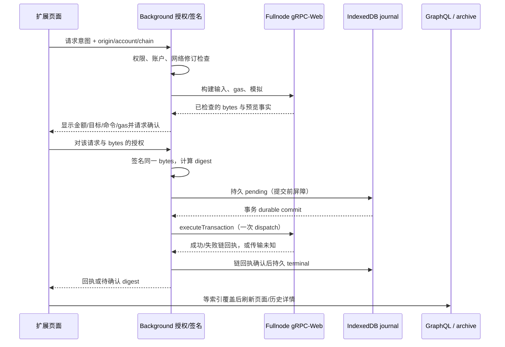

# 05 · 交易签名、执行与恢复

> 2026-10-12 语义核对：初始源码评估和带日期实施记录保留其原始时点；设计约束继续有效，历史“待实现／未完成”不覆盖后续验收。 当前构建与真实业务来源见 [C281](./workLog/20261012-C281-business-traffic-completion.md)，当前环境及未收口合同见 [第 14 章](./14-开发验收包安装与回归说明.md)／[剩余工作量](./leftProgress.md)。

> 2026-10-03 初始合并基线：当时的局部改动撤销与待实施状态保留为历史。正文功能合同继续有效，现行完成状态由 Task.md、totalProgress.md 和 workLog 的最新证据决定。

日期：2026-10-02。保留原钱包 background 签名和 durable recovery 的核心约束，只更换构建／模拟／执行／读回执协议。

## 1. 原有合同与需要更新的内容

2026-10-03 初始盘点读取了当时的 WalletSigner、BackgroundServiceSigner 与 WalletStandardInterface，基线没有 transactionRecovery.ts 或 transactionRecoveryBrowser.ts。现行恢复已由 wallet/src/shared/rpc/execution-journal.ts（直接封装 IndexedDB）、execution-coordinator.ts 与 wallet/src/background/execution.ts 等实现；以下约束继续有效，完整签名恢复状态见 C190，当前 G4 冷恢复及原 pending 保留见 C280。

目标 recovery 必须以 chain／generation／account 锁定，IndexedDB 写事务完成后才提交；pending 存在时不重建／重签／重发。签名 bytes 必须与预先计算 digest 的 bytes 相同。保留这些约束，改造新 Core 联合结果及 journal schema，不用一次 `client.signAndExecuteTransaction()` 绕开持久提交边界。

历史已撤销实现使用 effects.status.status；新建 journal 使用 `Transaction/FailedTransaction.status.success`，需显式映射。源码存在 recovery 不证明其已满足新端点／新返回合同，必须重跑对应验收。

## 2. 从用户意图到提交



现行授权与 dispatch 由 background/execution.ts、dapp-execution.ts 和 shared/rpc/execution-coordinator.ts 协调，UI 负责展示与用户操作。初版 UI signer 的缺口已经迁移；popup 关闭／worker 中止仍须按实际 journal 与恢复证据核验，不能仅凭函数位置声称全程事务性。worker 被终止时依靠已提交 journal 恢复，长任务分阶段处理，不依赖常驻内存。

### 2.1 构建与预览合同

1. 锁定 requestId、origin、account、完整 chainId、dev generation、network revision、endpoint fingerprint；验证账户已解锁并有权限。
2. Transaction.from 解析请求，设 senderIfNotSet。外部声明 sender 与所授权账户不同则拒绝；受支持的 sponsored gas owner 与 sender 分开验证。
3. 当前 Fullnode client 解析 Move 输入、owner／version、引用 gas 与协议参数；对象类型来自同链数据。金额解析使用精确整数。
4. 默认检查开启的 simulateTransaction 用于 gas／效果预览；include effects、balanceChanges、transaction、必要 commandResults。带 checksEnabled:false 的调用只用于明确调试，不作为签名批准依据。
5. 预览展示接收地址、币种／数量、gas 上限、赞助方、系统／未知命令、对象变动和模拟失败。名称解析输入及最终地址同时展示。
6. 最终 gas budget／payment、sender、expiration 和 Transaction bytes 确定后，才让用户确认。任何 bytes 改变必须重新模拟、展示并授权，不得确认后偷偷重建。
7. 本地对**最终 bytes**计算交易 digest；background 签名返回 bytes／signature，bytes 相等且 digest 相同才可进入 dispatch。保持原 TransactionData 与 PersonalMessage Intent 分离。

模拟会变旧，不保证真实执行成功；执行时节点才是最终状态判定者。模拟响应里的 digest 差异不构成签名摘要证明，摘要必须由最终 bytes 在本地计算。

### 2.2 Gas 与新余额模型

- 展示总余额与实际 gas coin／address balance 不等价。用 Fullnode 的 build 插件与当前协议处理 gas选择，不能只用 GraphQL 的资产列表。
- 新 SDK 的 simulate 可有 doGasSelection 等传输增强；采用当前源码合同，不人为拼旧 gas 参数。
- Sponsored transaction 不覆盖外部 gasOwner／payment／signature；只有请求及同链能力明确支持时启用。缺少必要签名不能自动改为钱包自付。
- 新 protocol 支持的资金形式需要独立测试：普通 coin 对象、多个 coin 合并／拆分、addressBalance 与受支持 gas 模式。服务或链未开启的模式应明确禁用。
- 预览失败后不发送；版本过期、余额变动或 epoch 更新要求用户重新发起一笔新授权，不在重试里自动重签。

## 3. 提交记录与状态机

### 3.1 现行 journal 合同（version 2）

| 字段 | 含义 |
| --- | --- |
| schemaVersion | 2，与现有 v1 区分 |
| chainId／generation | 完整 H0 digest 与显式 dev 重建代次 |
| accountId／accountAddress | 本地账户及所授权地址，规范化验证 |
| requestId／originRef | 内部授权关联，origin 不作为可随意更换的输入 |
| digest／createdAt | 最终 bytes 摘要与记录时间 |
| state | dispatch-pending、confirmed-success、confirmed-failure；UI未知细分可另存 |
| endpointRevision | 当时执行配置，用于审计；不能把换 URL 当另一条链 |
| receipt | 最小可证明的 digest、status、checkpoint、effects BCS／来源；按需保存 |

不持久化私钥、助记词、解锁口令或用于自动重放的完整待提交 signed payload。旧 v1 数据保留并隔离未知身份，不能启动旧执行实现重放；现行 version 2 的 records／locks／meta 由 IndexedDB 事务维护。

**锁键为完整 chainId + generation + account，不能包含 endpoint URL／profile alias。** 同一条链配置两个别名不能绕过“已有 pending 禁止再提交”；反之换新 genesis 时也不能错误阻止另一个链账户。缓存键与执行锁键用途不同，见 06。

### 3.2 状态转换

| 状态／事件 | 转移与动作 |
| --- | --- |
| 用户取消或 build／sign 失败，尚未写 pending | 不提交，可重新发起；不制造链失败回执 |
| durable pending 写失败 | 禁止 dispatch，报本地恢复存储不可用 |
| 写 pending 后进程关闭，未确定是否 dispatch | 保持未知，通过原 digest 查询；不默认重发 |
| execute 返回完整成功链回执 | 校验 digest／chain／status，持久 confirmed-success |
| execute 返回 FailedTransaction | 同样是终结链回执，持久 confirmed-failure；展示 gas／执行失败，不当网络错误 |
| timeout／cancel／Unavailable／连接断开 | dispatch 后一律先未知；读回执，不重建／重签／重发 |
| 返回缺 digest、状态不全或 digest 不匹配 | 无法确认，保留 pending 并报告异常 |
| 回执持久写失败 | 即使链可能成功也保持可恢复 pending；下次重新查询同 digest |
| 用户切网／切账户 | 停止旧会话请求；保留旧记录，在正确 chain/account 下恢复 |

已写 pending 但实际上未 dispatch 的崩溃窗口无法仅凭本地记录判断。首版继续保守：不自动删除／重发；提供明确的“待确认”状态。未来若需要人工放弃／再次提交，必须另行设计授权和同 bytes 重放合同，不能用超时阈值自动解锁。

### 3.3 恢复顺序

1. 用户打开钱包或 background 被唤醒时，只读发现 pending；恢复与正常发送共享执行锁。
2. 重新校验当前同链身份与 generation，确保恢复的是原 digest；旧 UI点击不能确认新的请求。
3. 首先查 Fullnode Ledger.getTransaction，使用明确 include和超时；waitForTransaction 只是查询工具，不能代替 durable journal。
4. 若当前 Fullnode 已裁剪，归档确认同链、历史覆盖且满足必要水位，再查归档相同 digest。不能用“新节点 NotFound”证明未入链。
5. 归档落后则继续 pending，必要时 `x-rtd-min-checkpoint` 等待已知真实 checkpoint；不知道入链高度时，不凭空指定一个巨大数值。
6. GraphQL 可补充 UI展示及索引状态，但缺少该交易不能否定 Fullnode／归档回执。最终回执必须与 digest／状态一致后才能持久 terminal。
7. 即使请求账户窗口关闭、extension worker重启或连接切换，仍恢复原记录；不重新创建一笔“相同金额”交易。

## 4. Read-after-write 与页面状态

链确认和索引可读是两件事。执行结果立刻显示真实链回执；GraphQL portfolio／history 需要等对应管线的 availableRange覆盖该 checkpoint，不能用 sleep固定秒数代替就绪证据。

- UI保留已确认回执与“索引同步中”；刷新后新 snapshot包含该交易的变化才更新资产快照。
- 有界等待；超时不修改交易终结状态，不回滚成发送失败。
- 失效币余额、持有对象、history、stake与名称相关query，但不把互不一致的半页数据装进同一个portfolio。
- 同一pending禁止重复提交按钮；confirmed-failure允许用户**重新发起、重新预览与授权**，不能自动重用旧授权。

## 5. Wallet Standard 与 dApp 合同

### 5.1 发布必备能力

保留 `standard:connect`、`standard:events`、`standard:disconnect`，以及当前 SDK 的 `rtd:signPersonalMessage`、`rtd:signTransaction`、`rtd:signAndExecuteTransaction`。标准 method version、account、chain与返回类型按本地 wallet-standard源文件固定。

旧 `rtd:signMessage`、`signTransactionBlock`、`signAndExecuteTransactionBlock` 属 deprecated接口。本次迁移采用仅发布 modern features，已移除这三个注册及实现，开发dApp需改用现代方法。不得以兼容为由保留JSON-RPC后端。内部签名消息桥的transactionBlockBytes只是旧字段名，不会调用旧RPC。

官方wallet builders说明外部签名执行输出合同不因Core迁移改变；效果来源变为新结果的BCS。[Wallet Builders](https://sdk.mystenlabs.com/sui/migrations/sui-2.0/wallet-builders)。

### 5.2 新结果映射

```typescript
// 示意；必须经过 journal、回执及 effects 完整性校验。
const tx = result.Transaction ?? result.FailedTransaction;
return {
  bytes: toBase64(finalBytes),
  signature: localSignature,
  digest: tx.digest,
  effects: toBase64(tx.effects.bcs),
};
```

`include:{effects:true}` 必须请求，缺 effects.bcs 不能强制 non-null后返回空值。localSignature是所授权账户对finalBytes的签名，不能在多签／赞助交易里假设tx.signatures[0]永远等于本钱包签名。链失败回执、dApp Promise结果／错误语义按modernfeature合同测试。

signTransaction只签名，不广播；保留bytes与signature。signPersonalMessage使用PersonalMessage Intent，不依赖归档、索引或交易gas。事务JSON／对象从dApp输入时，在background重新解析与验证，不能相信页面转发的预览字段。

### 5.3 授权、通信与链标识

- content script是消息桥；不提供任意URL代理、RPC方法透传、密钥或网络配置修改。
- requestId、origin、tab/frame身份、allowedaccounts、chain与feature逐项检查；授权弹窗重开仍核验同一个请求。
- dApp给出的chain不等于当前RPC真实链；background映射注册profile并验证identity，不使用custom网络的“unknown”标签无条件授权。
- accountsChanged／chainChanged／disconnect及时发布；请求期间切网不能将旧签名结果回给新network请求。
- 钱包build选用Fullnode，不受dApp提供的client／URL控制。库的Transaction插件来源与未知命令必须校验／清楚展示，不动态下载并执行远端脚本。
- 原源码可能在审批窗关闭时删除request；改造须区分“用户拒绝”和“进程中断／已提交待恢复”，已提交journal独立于临时request生命周期。

### 5.4 dApp后台准备与只签名的编码进展（2026-10-03）

现代交易Wallet Standard入口要求显式account与chain，缺失不得回退默认账户或当前链；PersonalMessage的chain仍可选。后台以浏览器origin和当前profile固定请求ID、规范账户、chain、networkBindingKey、原文SHA-256及sign／execute模式。错链、非规范Web origin、sender与账户不符、无效模式和超限原文在存储／弹窗前拒绝；旧请求缺绑定必须重新发起。

prepareDappTransaction仅接收accountId与requestId，从后台持久请求读取原文，在Fullnode准备前后复核请求未批准／有效期、原文绑定、账户、当前权限及网络。最终bytes／digest保存于有容量上限的内存登记，返回随机approvalToken及五分钟期限；同请求新预览撤销旧凭据，worker重启需重新预览。登记不写journal或签名。

批准页通过DappPreparationContext让摘要、Gas和详情共用一个后台准备结果及凭据。查询按请求／账户／profile／UI读会话隔离，取消后丢弃迟到结果；后台独立readSession不冒充UI会话。批准点击再次检查凭据是否过期。

只签名redux分支已改调用signDappPrepared，不再使用旧signer重建交易。后台消费凭据后，以同链账户Web Lock互斥，存在journal pending则拒绝新签名；对原bytes正式模拟，以TransactionData Intent签名并验签，各边界重新检查请求／权限／账户／网络。现代bytes／signature在旧消息桥转换为transactionBlockBytes／signature，无重新编码或广播。

后台executeDappPrepared现已接UiConnection及客户端通信接口，从execute模式凭据消费固定bytes，委托WalletExecutionCoordinator执行正式模拟、Intent签名／验签、journal屏障、一次dispatch与终态落盘。confirmed返回批准bytes、实际签名与effects BCS；pending只返回本次digest与recordId，不把其它请求的pending误认为本次结果。journal已有终态但内存无签名时，以Ledger现代详情读取原bytes／signature，核对原receipt与摘要、effects、账户和交易Intent后返回，禁止重新签名或伪造结果。独立recoverDappExecution按授权requestId查询原记录，不接收外部digest／signature，不调用构建或dispatch；批准页pending现保持原请求并只读轮询，确认后通过恢复命令重新授权返回原结果。页面执行提交已接该命令，现代Wallet Standard直接返回bytes／signature／digest／effects，不再解析rawTransaction或取signatures[0]。

准备前后现均检查原请求journal及同链账户pending，已有记录或存储不可用时不登记新批准。交易批准页已去除useSigner及旧Qredo提交hook，redux交易分支不再调用旧signer；pending或执行命令响应中断时保留approved=null，不向dApp误报失败；初次journal核验完成前不挂载新预览，尝试执行后即使暂时无记录也保持恢复态，不自动重发。赞助多签、Qredo新执行路径、真实Chrome／链验收未完成。准备／签名的局部测试不能替代完整dApp交付。

请求生命周期现绑定发起请求的ContentScriptConnection实例。断连信号在异步创建前订阅，请求完成／拒绝／断连后释放订阅、撤销内存批准凭据并关闭批准窗口；已提交journal不删除。后台准备／签名／执行授权要求该请求仍有活动连接，断连会关闭相关读会话并拒绝迟到结果。worker重启后无活动连接的持久旧请求必须重新发起。多窗口请求的storage.local读改写已串行，避免一个请求清理覆盖另一个。实际Chrome导航／tab关闭及提交时worker故障仍待真实验收。

PersonalMessage批准页与redux已改为后台signDappPersonalMessage，不再依赖旧RPC signer／Qredo提交hook。后台按活动连接和持久请求核验原文、origin、账户、权限、有效期与锁定状态，在签名前同步占用请求防重复签名；结束连接释放占用。签名内容为PersonalMessage Intent加BCS vector<u8>，返回原消息base64。普通密钥本地验签不访问任何节点；zkLogin通过身份受检Fullnode VerifySignature(name=PersonalMessage,value=BCS vector)验证。此编码与当前RTD signature_verification_service.rs一致；zkLogin账户按主方案默认禁用，此验证工具不构成启用业务；多签／Qredo若未来启用需独立验收。

钱包根组件现仅保留WalletRpcProvider，已移除旧RtdClientProvider／KioskClientProvider；ApiProvider.ts只保留网络展示／默认环境常量，切网清理查询缓存而不创建JSON-RPC client。反诈骗预检复用后台固定准备bytes，缓存按profile／会话／request／digest隔离，不再通过旧client二次build。无调用方旧useTransferKioskItem及useSigner已移除；OriginByte新服务支持仍是未完成任务，不能以删除不可达代码代替功能迁移。

## 6. 必须执行的故障验收

并发两窗口同account发送、签名后bytes变化、pending持久失败、dispatch前后worker停止、RPC timeout但链已成功、成功回执落盘失败、失败链回执、未知摘要、归档索引落后、Fullnode裁剪、错链端点、切账户／切网络、popup关闭、dApp断连、赞助gas变更、导入账户签名、PersonalMessage离线签名。

每项保留授权、预先计算digest、实际链事实与journal终态；统计dispatch次数与签名次数。测试不能只断言界面文本或mock Promise，至少完整提交／恢复／链失败路径需真实dev链与Chrome。

## 7. 构建与正式模拟的编码合同

钱包构建器使用当前 RTD SDK 的 Fullnode gRPC resolveTransactionPlugin。该插件以服务器模拟解析 Move 参数、对象引用及 gas；其成功不能替代对最终 BCS bytes 的正式模拟。钱包领域接口只提供 prepare／simulate，不向 UI 释放可 execute 的 client；复制 Transaction 数据及内置 intent，不复制调用方可执行插件。外部 sender 与当前授权地址不一致，在联网前拒绝；显式赞助方、gas price／budget／payment 及 expiration 不能被解析响应静默替换。

每次构建／模拟共用独立读会话、调用方取消及总 deadline（默认20秒、最大60秒），并限制最多64个内部 unary 请求。SDK内部没有传递 signal 的调用也由受控 transport／Fetch 强制绑定；读会话关闭后拒绝迟到结果。保留gRPC status／trailers语义，不把HTTP200视为成功。操作前后核验完整H0、水位与保留区间；错链或退高拒绝结果。

解析响应必须显式包含成功状态、epoch、sender、kind和gas关键字段；禁止非空断言／默认值冒充可预览数据。最终 gas、sender、expiration 与 BCS 固定后，再发送只携带这些 BCS 的 SimulateTransaction：checks=ENABLED，Coin支付或gasless使用doGasSelection=false；空payment且gasPrice>0的地址gas使用true以禁止mock注入，并严格拒绝任何回传bytes变化，read mask包含transaction与command_outputs。核验回传transaction BCS逐字节等于请求、本地预计算digest一致、effects BCS完整可重编码、status／epoch／gasUsed／transactionDigest一致；现代预览transaction字段重新编码也必须与最终bytes一致。任何缺失、不一致或模拟失败不能生成签名批准记录；simulate的FailedTransaction仅为模拟失败，不冒充已提交的链终态。

prepare返回不可变的bytesBase64、digest、binding／readSession、sender、gasOwner、gas上限／价格、gasPaymentKind及现代完整模拟结果。普通coin、addressBalance与gasless明确分开；使用addressBalance付费必须有有效ValidDuring／Validity重放保护，不按coin对象数把可用addressBalance误判为零。具体资金模式仍须在同链能力及真实fixture中验收。

共享输入的协议比较须区分字段补全与语义变化。[Sui官方Input定义](https://mystenlabs.github.io/sui/sui_rpc_api/proto/sui/rpc/v2/struct.Input.html)明确旧 `mutable` 仍被填充并作为输入尊重，新 `mutability` 用于兼容新增非排他写；[官方枚举](https://mystenlabs.github.io/sui/sui_rpc_api/proto/sui/rpc/v2/input/enum.Mutability.html)为未知0、不可变1、可变2、非排他写3。本地RTD Rust SDK的 `rtd-rust-sdk/crates/rtd-rpc/src/proto/rtd/rpc/v2/transaction.rs`（当前Cargo／lock固定fd95c4566e88cda3c4e5e590deda4e6aff864700，与本地同一HEAD逐字核验） 共享输入输出同时填bool与枚举；TypeScript协议字段6／7对应一致。对明确使用旧bool的共享输入，审核可仅补其唯一等价枚举 true→2／false→1后精确比较，已有枚举必须一致；不能删除枚举、把未知或非排他写折叠成bool、容忍冲突或更改initial shared version。此兼容规则用于本次旧bool合同的独立审核，不声称泛化支持所有新输入形式。最终批准和正式模拟仍须逐字节核对规范BCS，不依赖此字段兼容代替bytes证明。

币发送表单的gas估算读取新鲜Fullnode coin并使用实际币种；表单修改、换账户或换读会话后旧批准失效。比较gas费用使用原子单位bigint，禁止按正在发送的token decimals再次换算RTD gas。进入预览后保留同一份批准bytes；发送前只重新模拟该bytes，不刷新选币、重建或暗中变更批准。失败要求重新预览与授权。名称解析、底层签名／执行器、durable journal及其它dApp／NFT／质押入口的迁移仍须按Task清单完成，不能仅凭本小节实现宣称可试用。

权威来源：[SuiGrpcClient 原生服务、read masks与response helpers](https://sdk.mystenlabs.com/sui/clients/grpc)，固定本地SDK的grpc/core.ts、client/transaction-resolver.ts及当前rtd的transaction_execution_service/simulate源码。协议合同优先于网页示例；未验证的服务能力和真实Chrome／链上结果不能记为通过。

## 8. Background 执行与 journal 的编码合同

批准入口携带不可变最终 BCS、预计算 digest、requestId、accountId 与完整网络绑定，background 自行取得当前账户／网络，不接受 UI 指定任意 client／URL。当前钱包内部发送命令复用已有扩展 UI origin 检查；内部 originRef 固定 wallet-ui，不能据此宣称 dApp 的 origin、tab、chain 和逐请求批准已完成。签名前重新模拟同 bytes，名称仍指向已批准地址且该地址确实是 TransferObjects 的输入；gasOwner 不同于 sender 时要求单独完成多方授权，不能暗中改成 sender 付费。

同 H0／generation／规范地址的 Web Locks exclusive 互斥覆盖模拟、签名、pending 写入与单次 dispatch；不可用或忙时禁止发送。锁不包含端点／别名。进入锁后先检查既有 request 和 durable pending；原 pending 只能通过同 digest 恢复，不能重新签名／发送。Web Locks 随 worker 停止而释放，不能单独承担持久占用；IndexedDB scope 占用跨进程保留。[Web Locks 规范](https://www.w3.org/TR/web-locks/)。

journal v2 使用独立数据库，记录与 pending scope 锁在同一 readwrite 事务原子写入，显式 durability:strict 并核对事务属性；仅 transaction complete 才 resolve。单个 request success、chrome.storage.set 或内存 Promise 完成均不是 dispatch 屏障。网络和签名不在 IndexedDB 事务中执行。strict 是浏览器持久性提示，原生浏览器验证其事务属性／完成顺序与重启后可读；不能把它声称为所有设备断电的物理存储保证。[IndexedDB 3.0 durability 与事务规范（工作草案）](https://w3c.github.io/IndexedDB/#dom-idbtransactionoptions-durability)。

落盘只写身份、摘要、授权关联、配置版本、状态及最小回执白名单，不存私钥、签名和完整可重放 signed payload。v1 store 不删除；旧记录无法证明完整 H0／generation 时保留并隔离，新提交拒绝，不能按旧四字节标签猜测迁移。升级阻塞、quota／abort、损坏记录、缺 scope 配对或不支持 strict 均禁止广播。

签名保留原 background 私钥域及 TransactionData Intent，正式 Fullnode SignatureVerificationService 对同 bytes／授权地址校验后才写 pending。dispatch 仅一次；之后取消、错链、超时、缺字段、摘要／BCS／signatures 不一致保持未知。完整终结回执必须核验原 bytes／digest、effects BCS／状态／epoch／gas 及现代数据重编码；成功和链失败都通过同事务写终态并释放 scope。回执写失败不解锁，不因 RPC NotFound 推断未上链。

近期恢复先 Fullnode Ledger.GetTransaction，显式 read mask 与有界请求；打开币发送页也发现同账户 pending，恢复按钮只查原摘要。同摘要的受限归档 fallback 已按第 10 节编码；background 自动唤醒、全入口协调和索引覆盖等待仍按 3.3、4 和 Task 完成。原生 Chromium worker harness 的停止／重启证据不等于真实扩展 worker、实际 timeout 已上链或实链回执验收。

zkLogin 获取当前 epoch 读取同一 H0 校验的 GetServiceInfo 响应；每次新读，移除旧 URL 别名与预计结束时间缓存。optional epoch 缺失和 epoch+2 超过安全整数上界拒绝，期间切网取消结果。该字段是节点最高已执行 checkpoint 的 epoch，不能当作归档快照 epoch 或验证者／质押系统状态的完整替代。[Sui 官方 Ledger proto](https://github.com/MystenLabs/sui-apis/blob/main/proto/sui/rpc/v2/ledger_service.proto)；固定提交与 SHA 见合并方案 evidence/official/sui-execution-browser-manifest.json。zkLogin credential 网络绑定及其余历史读取仍须单独迁移验收。

## 9. 现代交易详情与事件完整性合同

收据读取使用只读领域入口 readTransactionDetails，不向 UI 暴露可广播的 client。hasFullnodeSession只声明会话／transport存在，每次读取仍核验H0；GraphQL快照尚在准入或失败时，不阻断独立Fullnode收据读取。近期详情通过原生 Fullnode Ledger.GetTransaction，read mask 显式包含 digest／transaction／signatures／effects／checkpoint／balance_changes／events／timestamp。响应先校验同 H0 与水位、原 BCS 重算 digest、完整 effects 及状态／epoch／gas、交易重编码一致，再映射现代 Transaction／FailedTransaction 模型；不用旧 RtdTransactionBlockResponse 或旧 getTransactionBlock facade。

请求 events 不自动证明列表完整。存在 effects.eventsDigest 时，要求整组 TransactionEvents BCS 与 digest 字段；按 Rust Event 字段顺序逐项重新序列化，全部 bytes 及 typed Blake2b256 摘要必须一致。类型域为 TransactionEvents::，不能误用单个 Event 的无域摘要。未返回、被截断、遗漏字段、事件 bytes／类型／摘要不一致则拒绝详情，不按空事件列表展示。完整 gRPC 事件保留超过50项，不能以 GraphQL SDK 默认first:50列表代替全部事件。空事件与缺事件字段按 effects 事实区分；总数量与BCS大小有界。

时间使用当前 SDK 数值模型；要求 nanos合法、毫秒在安全整数范围、timestamp必须有checkpoint。余额变化按现代 address／规范币种和 bigint 归组；等额正负变化不能证明对手方／收款人。gas为computationCost + storageCost - storageRebate，不重复扣nonRefundableStorageFee，不转浮点；赞助方实际费用与当前账户支付金额分开。对象变化的ID／归属／状态／版本直接从effects BCS导出，protobufobjectTypes仅为索引层的类型补充，不将当前对象display冒充历史事实。

StakingRequestEvent／UnstakingRequestEvent 按当前rtd-system validator.move字段顺序解析BCS，u64保留字符串／bigint；不使用不稳定的event.json，不将大额principal／reward转Number。展示全部当前staker的事件，不只取第一条；gas／余额／对象变化与质押卡片同时保留。旧验证者／APY／epoch时间下游仍必须完成独立查询迁移，不能因收据基础类型改动就宣称质押入口无旧RPC。

查询缓存绑定完整profile与独立readSession，拒绝切网迟到结果，不从navigation.state旧RPC响应或持久缓存导入未经验证的收据。单次请求有界，NotFound作为未知返回，页面自动再查询有次数上限并提供手动刷新；Unavailable／坏字段展示详情不可用，不改变journal终态或宣称执行失败。长期裁剪同摘要读取已按第10节编码，独立accountHistory入口与活动页按SDK矩阵第8节接入；已确认journal独立发现已按第11节编码；实链裁剪恢复及写后读仍按3.3、4和Task验收。

权威依据：固定Sui源码effects/mod.rs的TransactionEvents::digest、crypto.rs的BcsSignable域、event.rs的字段序列；本地RTD同源结构、SDK grpc/core.ts及validator.move。官方固定源码与SHA在合并方案evidence/official/sui-receipt-events-manifest.json；当前debug库的原生Rust交叉向量／编译运行记录在合并方案evidence/20261003-event-envelope-rust-proof.json。它们是字节／摘要编码证据，不能作为实链或真实Chrome扩展验收。[官方TransactionEvents源码](https://github.com/MystenLabs/sui/blob/c860146823abcedef45a1b5a9c766920be98a29c/crates/sui-types/src/effects/mod.rs)，[官方签名序列化域源码](https://github.com/MystenLabs/sui/blob/c860146823abcedef45a1b5a9c766920be98a29c/crates/sui-types/src/crypto.rs)。

## 10. 裁剪后的同摘要只读恢复合同

WalletLedgerReader 是独立只读 reader。其私有 binary gRPC-Web 客户端只允许当前 profile 精确 URL 下 Ledger.GetServiceInfo／GetTransaction；归档不能接收 State、Execution、签名验证或名称请求。UI read Provider 使用该 reader，background 的 lookup／details 也转交该只读实现，dispatch 始终只使用 Fullnode。地址、URL 别名和端点变更不改变原 journal 摘要。

每个角色先后核验完整 H0、最高可读 checkpoint、合法保留下界及请求返回选择器。最高水位退后拒绝；下界降低可能代表数据恢复，不当作错链。归档必须明确声明交易保留下界，且返回真实 checkpoint，返回高度必须位于末验覆盖内。水位只是受控服务的覆盖声明，BCS、摘要及状态一致性校验不等于 quorum checkpoint 验签或 authenticated-events 证明。

近期读取只在实际 gRPC NOT_FOUND、已核验 Fullnode 保留下界大于 0 且配置了归档时，按同一个 digest 尝试归档。这个条件说明节点存在裁剪，不能证明未知 digest 确实入过链；两端查不到仍保持未知／pending。缺 transaction、Unavailable、权限／协议错误、错链、坏 BCS 不触发归档替换。归档落后／覆盖不足拒绝接纳，不能解锁或重发。未知入链高度不伪造 x-rtd-min-checkpoint，也不发送可信 visible／identity header；已知 checkpoint 等待合同仍按 3.3 实施。

整个 Fullnode→archive→BCS 核验共用 20 秒总预算（配置上限 60 秒），继承调用方取消及切网 fence。恢复入口只读取原摘要并写经核验的终态，不构建、不签名、不 dispatch；任何失败仍由协调器保留 pending。受控 protobuf／BCS 测试不能替代归档浏览器桥接、debug 链裁剪 fixture、完整归档 checkpoint／对象版本读取或 worker 自动唤醒验收。

该选择与 [Sui 官方归档使用说明](https://docs.sui.io/develop/accessing-data/archival-store/using-archival-store)一致：客户端显式选择归档端点，Fullnode 不自动兜底；高信任独立证明须另行验证。固定官方 proto、源码与查询证据见合并目录 evidence/official/sui-ledger-history-manifest.json 及 sui-execution-browser-manifest.json。

## 11. 已确认 journal 的独立发现与详情不可用呈现

journal.confirmedReceipt 使用现有 scope 索引进行只读查询，scope 仍为完整 H0／generation／账户地址，不含 URL、profile别名或端点revision。查询逐条验证记录及 effects BCS，最多扫描10000条该scope记录；旧数据隔离、损坏、超预算和相同摘要的终态事实冲突都拒绝接纳。pending 不能作为已确认记录；只读发现不能清除、终结或改写任何 pending。相同摘要已有终态而后来仍存在 pending 时，展示旧终态不会自动解除当前执行互斥。

同摘要终态必须具有相同状态／epoch／effects BCS；两个已知checkpoint不同视为冲突，一个未知checkpoint可以由一致的已知值补充。读取返回字段白名单：摘要、状态、checkpoint、epoch、effects BCS和原读取source，不释放requestId／origin／签名／bytes／密钥。数据库重新打开以后也能读取已完成的原子终态，无需依赖旧request生命周期或详情服务在线。

extension UI 增加独立 readStoredReceipt 命令。background 核验当前完整profile绑定、选中账户id和初始地址，读后再次授权／会话fence；允许已锁定账户读取这些公共事实，删除、切换、错绑定或地址改变拒绝迟到响应。该入口不进行构建、签名、Fullnode／archive请求、dispatch或终态写入。派生运行环境的重新握手／全入口恢复仍按NET／TX任务处理，不能把本地记录当作当前服务能力就绪。

UI query key含profile binding、独立session、账户id／地址及digest；禁持久化，10秒单次读预算，尚无终态的自动再查有次数上限，手动刷新同时重读journal与详情。网络／账户切换和取消拒绝迟到数据。纯查询hook与UI账户／background适配分开，核心类型检查不通过导入旧钱包全量依赖实现。

收据页先保留经核验的持久成功／链失败状态。Fullnode／archive暂时不可用、尚无富详情或普通NotFound时，展示确认状态、摘要及已知checkpoint，同时说明详情暂不可用；不造空余额／事件或旧RPC DTO。新详情的摘要、状态、epoch、effects BCS及两个已知checkpoint必须与旧确认记录一致，冲突详情拒绝展示且提示重新核验，journal不改写。该功能不替代pending自动恢复、真实worker唤醒、GraphQL写后读或全部签名入口。

验证包含原生Chromium重新打开数据库的终态查询、H0／generation／账户隔离、只读不清pending与冲突拒绝，以及实际background授权、message客户端、新hook和状态选择。原生browser harness不是实际扩展UI／实链验收，未执行的TRY／QA不能记通过。

## 2026-10-03 后台只读恢复唤醒编码进展

background 每次 worker 求值同步注册恢复事件，覆盖 runtime.onStartup、runtime.onConnect、网络／账户／账户状态变化及一分钟 alarm。每次启动检查 alarm 是否存在，缺失时重建，不重置已存在周期；alarm 只负责唤醒，持久 journal 才是待确认记录的来源。此模式依据 [Chrome alarms 文档](https://developer.chrome.com/docs/extensions/reference/api/alarms) 和 [service worker 事件注册文档](https://developer.chrome.com/docs/extensions/develop/concepts/service-workers/events)。定时器可能延迟，不能承诺一分钟内确认或依赖 worker 常驻。

恢复每轮重新读取唯一选中账户；无选中或多选异常时不猜测作用域。允许锁定的签名账户只读恢复，复用当前 profile／H0／generation／地址隔离、执行锁、原摘要查找与写回前授权复核；不要求原 dApp 连接仍存活，因为后台只确认已持久化的链状态，不向 dApp 重放结果。事件在运行期间合并，并保留切网／切账户期间到达的新唤醒以再检查当前作用域。旧网络／未选账户的 pending 保留，重新选回时恢复；未导入账户不猜测，任何查询失败／NotFound 均不清 pending、不重建、不签名、不 dispatch。

30 项相关定向测试、完整 TypeScript 与开发构建通过；真实 Chromium 153 加载实际扩展，确认一分钟恢复 alarm 注册、欢迎页与只读 Port 通信正常，pageerror 为 0。该探测使用空账户配置，不证明实际 pending 跨 worker 终止／重启、实链回执或 dApp 返回已验收。该阶段未勾选TX-07／TRY；其后TRY-03／04已有真实链执行及pending跨浏览器／worker重启证据，TX-07完整切网切账户与NotFound矩阵仍待。

## 2026-10-03 收据与资产索引覆盖分离

收据页现保留链上成功／失败事实，并单独显示资产同步状态。首次进入已知checkpoint收据时请求一次共同资产快照刷新；之后沿用Provider有界读取与周期准入。只有同network binding的已准入共同快照checkpoint大于等于收据checkpoint，才清除同步提示；刷新请求成功本身不能代替覆盖证明。读取失败、错链快照及未知checkpoint继续显示同步中，不修改journal链终态，也不触发签名或重发。快照换代仍通过统一assetSnapshotKey刷新所有资产领域，不能把多次读拼成同一快照。

checkpoint使用规范十进制u64与bigint比较；新的read session会重新检查，旧query不能覆盖新作用域。已确认但checkpoint尚空的富详情继续执行既有次数上限内的只读轮询。20项相关定向测试和完整类型检查通过；真实索引延迟、收据页浏览器与完整写后读验收尚未完成，TX-08不勾选。


归档接口运行核验更新（2026-10-04）：实际配置的归档gRPC-Web入口完成checkpoint914按高度／摘要读取一致性校验；实际钱包Ledger reader对已知历史交易先查Fullnode，在NOT_FOUND和保留边界条件成立后按同摘要取得归档成功回执与详情。结合明确对象版本批量证据，RPC-19／20接口合同已核验；checkpoint仅为service-reference，未新增独立委员会签名验证或包含证明。Chrome、跨worker真实journal恢复及完整ENV门槛仍独立验收。此前阶段性“归档入口未验证”描述保留为当时记录。


历史／收据轮询补充（2026-10-04）：近期详情与本地journal查询的自动轮询上限按成功和失败响应合计计算，先返回null后持续错误也不得无限查询；当前每个query生命周期最多10次自动读取，手动刷新可继续只读查询。错误不构造链失败回执，不清理pending，也不触发再次dispatch。活动页仍只声明已认证窗口与覆盖范围，收据经核验的本地链终态可独立于富详情服务可用性保留。

后台名称授权补充（2026-10-04）：后台独立解析后，在每次账户／网络授权复核完成时检查该名称结果单调时钟期限，覆盖签名前与签名后等待。当前收款bytes识别只支持TransferObjects，OriginByte P2P MoveCall的名称地址绑定尚未实现，RPC-21重新打开；必须核对显式执行包、ABI与已有目标Kiosk的新鲜owner后才能闭合此分支。

OriginByte名称收款编码补充（2026-10-04）：后台已识别显式executionPackage的单条ob_kiosk P2P调用。创建目标分支核对第二参数Pure地址；已有目标分支通过Fullnode点查Kiosk，核对Shared初始版本及精确BCS中的UID、owner、扩展状态。混合P2P调用拒绝，不用任意Pure输入充当目标证据。此编码不代替后台集成／真实名称服务及Chrome验收，RPC-21暂保持打开。

OriginByte名称收款后续核验（2026-10-04）：两种P2P交易已通过后台命令与协调器集成，核对Intent原bytes、pending先于唯一dispatch；真实Fullnode目标Kiosk owner只读校验通过。RPC-21按编码范围恢复完成，真实registry／改名续费／Chrome仍待QA-A15，不把此只读证据当成完整名称转账验收。


### 后台原始签名消息关闭（2026-10-04）

UI 到后台不再暴露 signData／signDataResponse 通用原始签名消息。旧消息在读取账户前明确拒绝；background 内部账户 signData 仅由已授权的交易执行、dApp 只签名及 PersonalMessage 路径调用，并分别执行 Intent、批准 bytes、授权重验、签名核验以及适用的 pending／执行锁合同。不得通过恢复旧 UI 方法绕过协调器。证据见钱包 workLog/20261004-raw-signing-removal.md；动态 Chrome 验收仍单列。


### PersonalMessage 异步授权会话边界（2026-10-04）

个人消息即使使用普通密钥离线验签，也从首次账户读取之前监听网络、账户和请求生命周期变化。等待账户／权限／签名期间发生切网，不再交付迟到签名；失败路径移除监听器。accountId/requestId 先校验格式和长度，初次及后续账户对象 ID 必须与批准账户一致。普通消息仍不依赖链上查询或 GraphQL；取消语义不改变 PersonalMessage Intent。测试证据见钱包 workLog/20261004-personal-message-session.md。


### 交易入口初始化取消边界（2026-10-04）

withExecutionAccount 必须在首次异步网络／账户读取之前监听网络及账户事件，不能等待 WalletReadSession 创建后才开始监听。初始化期间切网再切回原配置、切换活动账户、账户状态变化或账户集合变化均使旧操作失效，不能靠最终 binding 相同继续签名。每次初始化 await 后检查取消；失败与正常退出都移除监听。该边界覆盖钱包提交、dApp准备／只签名／执行，以及使用该账户作用域的只读恢复入口。证据见钱包 workLog/20261004-execution-init.md。


### 后台签名编码核验（2026-10-04）

TX-02 编码合同已逐项核验：导入／助记词账户的三种本地密钥方案对相同最终 bytes 的签名与当前 SDK 一致，TransactionData 与 PersonalMessage 域隔离，UI 账户序列化不携带签名私钥。官方固定源码对标与8文件121项测试见钱包 workLog/20261004-TX-02-completion.md。该完成状态不代替授权生命周期、持久恢复与真实扩展验收。


### dApp批准页交易有效期（2026-10-04）

批准页新增TransactionValidity，从与批准凭据相同的prepared.bytesBase64解析expiration，而非可变原始dApp Transaction。None明确未设置，Epoch显示最后有效epoch（包含该epoch），ValidDuring／Validity显示epoch起止；Validity的allowedProposers显示所绑定委员会epoch和索引，不冒充验证者身份或永久限制。中英文同步。

对缺失／解码失败及SDK旧Epoch unsafe_u64产生的不安全整数范围，显示无法读取，不展示舍入epoch；批准按钮及onSubmit均拒绝。当前RTD源码将min/max timestamp标为未实现，因此非空时间戳限制显示不支持并阻止批准，不虚构时间单位。此展示修复未改变后台重新模拟、固定bytes签名或一次提交。

对标[Sui官方TransactionExpiration](https://github.com/MystenLabs/sui/blob/main/crates/sui-types/src/transaction.rs)与本地rtd/crates/rtd-types/src/transaction.rs：Epoch含上界、ValidDuring重放保护、Validity限定委员会语义一致。SDK Epoch超大值编解码精度问题仍需独立整改；该UI防护不代表所有底层大整数已解决。钱包workLog/20261004-validity-preview.md记录验证，TX-01保留未完成，Chrome批准全链路另验。


### Epoch全u64范围精度整改（2026-10-04）

SDK源头已修复TransactionExpiration.Epoch的两个损失点：BCS由unsafe_u64改为u64，解码返回十进制字符串；v1 JSON对安全范围保留数字，对更大epoch输出字符串并支持恢复。Transaction JsonU64拒绝不安全number，要求调用方使用精确字符串，防止签名前输入已被舍入。None、ValidDuring、Validity及其链／nonce／提议者字段不变。

这是公开BCS解码类型变化，已按SDK规则新增major changeset，未直接修改版本号。钱包批准页现可准确展示大于MAX_SAFE_INTEGER的Epoch字符串，保留对不安全number、无效bytes和未支持时间戳限制的防护。旧日志中“超大Epoch尚未修复”是上一阶段状态，以本节和钱包workLog/20261004-epoch-precision.md为准；TX-01完整授权及Chrome验收仍未完成。

钱包prepare对显式expiration的约束比较同步改为BCS编码比较：数值相同的42与"42"视为同一有效期，真正的epoch／窗口变化仍拒绝；避免SDK改为精确字符串后按JSON类型差异误拒绝。新增真实SDK准备器测试覆盖数字42、字符串42、9007199254740993和最大u64。


### 提交窗口关闭后的持久 pending 验证（2026-10-04）

原生 Chromium 使用实际协调器、IndexedDB strict commit 和 Web Locks 验证：提交页面关闭导致锁自动释放后，另一页面即使更换 profile 别名、revision、端点、请求和合法交易 bytes，仍返回同 H0／generation／账户的旧 pending，不能再次模拟、签名、验签或提交。恢复只查原摘要；lookup 返回 null 不释放 pending。该故障组合与原有 worker 重启测试合计 14 项通过；网络 reader 和签名为测试替身，不代表扩展 popup／worker 与真实链端到端验收。


### 混合资金发送全部的 Coin 覆盖检查（2026-10-04）

Sui 官方 `select_gas` 对真实 Gas Coin 迭代使用 `max_gas_payment_objects` 上限；RTD 当前同名实现也有此限制。自动加入地址余额 reservation 不会取消真实 Coin 选取上限。因此正式模拟成功并不能独立证明 GasCoin 转移覆盖了页面读取的全部 Coin。

钱包混合原生资金“发送全部”在正式准备返回后、交付批准预览前，从最终 bytes 解码 gas payment，逐个核对新鲜 Coin 的 objectId／version／digest。缺项或引用变化即拒绝本次预览，不能悄悄降级为部分发送，也不能在批准后重新构建补发。该检查针对已观察到的 Coin 集合；地址余额 reservation、并发新增余额、真实大对象数量与协议限制回归仍须按 RPC-04／TX-01 验收。

依据：[Sui 官方模拟源码](https://raw.githubusercontent.com/MystenLabs/sui/main/crates/sui-rpc-api/src/grpc/v2/transaction_execution_service/simulate/mod.rs)，2026-10-04 读取的 main 快照；钱包 workLog 保存同日源码与 SHA-256。RTD 对应 `crates/rtd-rpc-api/src/grpc/v2/transaction_execution_service/simulate/mod.rs` 的 `select_gas`。


### 2026-10-04 实际扩展只签名与后台消息字节合同

后台使用的原生 fetch 必须保持 WorkerGlobalScope 接收对象；WalletTransactionReader 默认 fetch 绑定 globalThis，避免 Node 单测通过而 Chrome worker 报 Illegal invocation。prepareDappTransactionResponse 的 simulation 含 Uint8Array BCS，必须通过 PreparedTransactionWire 的规范 Base64 字节编码传输，UI 解码后方可解析 effects；不能假定 Chrome 消息保留 typed array。Chrome [官方消息序列化说明](https://developer.chrome.com/docs/extensions/develop/concepts/messaging#serialization)明确 JSON 语义。后台批准凭据仍绑定原始固定 bytes，UI不能替换交易。

实际扩展已通过 modern Kit 交易只签名：批准页摘要等于返回 bytes 的摘要，签名验签成功，5次模拟、0次 ExecuteTransaction；公开测试账户仅一次本地faucet领币，未触碰已有pending。最终117文件1253项／钱包类型检查／开发构建及四入口审计通过。精确dev SPKI例外和编译Local profile不等于正常CA／自定义权限验收；该阶段尚未执行交易；其后TRY-03已由真实execute证据完成，见本章TRY-03小节。阶段证据：rtd-apps/wallet/migrationToGRpcOrGraphQLDoc/workLog/20261004-dapp-sign-only.md。


### 2026-10-04 TRY-03 实际 dApp 核心链路完成

真实无界面Chromium加载当前扩展，连接授权、PersonalMessage、交易只签名和交易执行四条链路通过。执行摘要5yEbxH4Ex5GUhQ1LwEWPrvQqcwppJGByLHiiuQUcBL4j与批准预览一致，签名／effects成功校验通过，ExecuteTransaction仅1次；整个浏览器重启后同一confirmed-success journal保留。测试profile永久保留，批准前记录原摘要，已存在目录禁止重新初始化，失败也不删除journal。

证据：rtd-apps/wallet/migrationToGRpcOrGraphQLDoc/workLog/20261004-TRY-03-completion.md。TRY-03完成不代表TRY-04故障注入恢复、TX完整授权矩阵、正常CA／自定义host权限及人工试用完成；当前仍不可完整试用。


### 2026-10-04 TRY-04 实链超时与重启恢复核心验证

复用同一保留profile，在确认无pending后批准一次新交易。实际worker的ExecuteTransaction已得到节点响应，测试将其扣留至原生AbortSignal超时，并暂阻后续回执读取；实际journal仍为dispatch-pending。关闭批准popup和整个浏览器，再由新worker只读恢复同摘要4EqnBaAX7Bnb3j1iqnPsaw5efscHEwd2UUCr2ZrSicLN，持久记录转为confirmed-success，Fullnode回执checkpoint255912。整个流程仅dispatch1；另一次锁定账户恢复复核为0模拟／0提交。

证据：rtd-apps/wallet/migrationToGRpcOrGraphQLDoc/workLog/20261004-TRY-04-completion.md。受控响应丢失测试完成TRY-04核心组合路径，不等于自然网络故障、独立worker强杀所有窗口或全部切网／切账户／NotFound矩阵。已有marker禁止新提交模式重跑，保留原profile、journal和原摘要，只可--recover-only查询；正常CA／权限和完整试用仍待。


### 2026-10-04 RPC-15 模拟接口完成核验

正式模拟及所有编码入口已迁移：币发送／NFT／质押使用领域prepare与同bytes重新模拟，dApp后台固定bytes凭据与共享Gas／详情／effects预览已接通；不再是“批准提交待迁移”。checks=ENABLED和按资金形态选择的最终模拟模式（地址gas修正见本章补充）、原生BCS／摘要／字段一致性、失败联合类型及会话取消均经相关合同核验。11文件185项与当前四入口静态审计通过，实际扩展预览／只签名／执行及重启恢复有TRY-03／04证据。

工作日志：rtd-apps/wallet/migrationToGRpcOrGraphQLDoc/workLog/20261004-RPC-15-completion.md。RPC-15完成不代表NFT／混合资金、完整赞助／授权矩阵及正常CA／权限或整体试用完成；当时发现的TX-09 PersonalMessage可选chain传递缺口已由下文修复核验覆盖。

### PersonalMessage 可选 chain（2026-10-04）

对齐官方Wallet Standard 1.1可选chain输入，页面、消息、批准记录与后台签名前后完整传递并复核。显式chain必须等于当前钱包公开的链标签；省略时保持普通离线消息支持，不产生链查询。标签仅为授权上下文，不改PersonalMessage Intent、不绑定H0或增加密码学跨链防重放承诺。创建请求前已监听断连，异步配置读取期间断连不留下批准请求或弹窗。

实际扩展正常消息验签及直接Wallet Standard错链调用拒绝通过，错链零批准窗口，整轮零模拟／零执行；117文件1266测试、钱包类型检查、开发构建与新四入口审计通过。使用编译Local配置与精确SPKI例外，正常CA／自定义权限与完整TX-09／TX-10仍待。证据：rtd-apps/wallet/migrationToGRpcOrGraphQLDoc/workLog/20261004-TX-09-followup.md。

### 自定义网络的 Wallet Standard 发现（2026-10-04）

wallet.chains包含内置链与当前自定义链，保证account.chains为其子集。状态与连接事件同时公布chains和accounts，切换后不残留旧自定义链标签。4文件69项回归与钱包类型检查通过，实际自定义权限／Chrome切网仍待。证据见钱包workLog/20261004-wallet-chains.md；同次审计发现transaction可选AbortSignal尚未建立后台取消协议，TX-09／TX-10继续打开。

### 交易 AbortSignal 通路（2026-10-04）

现代signTransaction／signAndExecuteTransaction的AbortSignal留在页面，以原消息ID向同一后台port取消；后台在权限等待前登记，贯穿批准请求生命周期，撤销prepared并关闭窗口。不得把signal本体序列化，不得因取消清除持久pending／重新提交。全量120文件1280项及随后公开接口8项、钱包类型检查通过；主动取消的真实扩展与dispatch后恢复专门验收仍待，TX-09／10继续打开。详见钱包workLog/20261004-dapp-abort.md。

### 主动取消实际扩展核验（2026-10-04）

当前dist在真实无界面Chromium中完成sign-only／execute各三例：调用前abort、序列化等待中abort、批准请求已持久化且窗口打开后abort。前两类零弹窗，后一类取消关闭窗口，六例均无结果且批准记录清空；整轮0模拟／0提交。模拟中、签名中与提交后取消／恢复尚未由本轮证明。证据：钱包workLog/20261004-dapp-abort-live.md。使用编译Local及精确SPKI测试例外，整体试用与TX-09／10仍未完成。

### 提交后主动取消的当前证据（2026-10-04）

真实批准生命周期与执行协调器的取消联动4新场景及相关73项通过，覆盖模拟／签名等待及dispatch后pending恢复，但journal／网络仍是测试实现。随后实际扩展仅提交一次tzHhXCPSvrJ95g4u6mWqtdU2cmZm6tULha6Vrq812KT，主动取消后的观察断言超时，不能记为取消验收通过。未重发；重启后账户锁定状态只读原摘要恢复成功，checkpoint267087，恢复0模拟／0提交。失败阶段定位仍待，详见钱包workLog/20261004-dapp-abort-coordinator.md。

### 保留扩展档案的构建一致性（2026-10-04）

磁盘bundle哈希不能证明保留浏览器档案运行相同代码。已用CDP执行源码确认此前提交后取消测试运行旧worker（不含取消协议），并重载后确认当前worker与磁盘一致、旧三条journal保留且锁定只读恢复通过。测试启动新增运行源码检查，旧失败不代表新版实现验收。新档案的真实模拟中主动取消两种方法通过（窗口关闭／批准清空／传输会话取消），零执行；当前版本提交后取消仍待。证据见钱包workLog/20261004-worker-cache-cancellation.md。

### 当前worker的提交后主动取消通过（2026-10-04）

经CDP证明当前后台与构建一致，旧三条journal均终态后新请求CDaQEspaBbXHQxDiG9R6GzYmfX6eAB4yYa7X1CubRvHC只提交一次。真实节点响应暂扣期间调用方取消，批准窗口关闭、传输明确因会话取消而非timeout结束，pending跨完整浏览器重启；锁定账户按原摘要恢复成功cp270250，四条journal保留。整轮dispatch1／simulation5，不能解释为撤销已上链交易。证据见钱包workLog/20261004-dapp-abort-verified.md；现代交易入口缺account时的旧回退仍待移除，TX-09／10继续打开。

### 现代方法要求显式账户（2026-10-04）

sign-only／execute已移除缺省account时使用首个已授权账户的旧回退；三个现代方法在序列化／消息发送前要求有效account.address，后台仍独立复核权限与绑定。121文件1289测试、钱包tsc、dev构建与四入口审计通过。实际扩展缺账户三入口零弹窗，正常消息与交易只签名验签通过，5次模拟／0执行。证据见钱包workLog/20261004-explicit-account.md。下一步仍须移除交易缺省chain的旧兼容，PersonalMessage可选chain不变，TX-09／10继续打开。

### TX-09 现代接口合同完成（2026-10-04）

三现代方法版本、输入输出、PersonalMessage可选chain、交易account／chain必填、AbortSignal原连接取消及BCS结果合同已核验完成；移除交易缺链的旧兼容。最终121文件1293项、钱包tsc、dev构建与四入口审计通过，最新实际扩展缺链拒绝／消息省略chain验签／正常只签名通过，5模拟0提交。执行及提交后取消恢复参照已有当前worker独立证据，不称本次又提交。完成核验详见钱包workLog/20261004-TX-09-completion.md。TX-10完整授权事件矩阵、QA及正常CA／权限仍未完成。

### 授权账户快照与断开确认（2026-10-04）

钱包注册后静默恢复已授权账户；页面用状态／刷新版本拒绝迟到查询覆盖撤权事件，无权限或当前刷新失败清空账户。disconnect等待后台按浏览器origin持久删除权限后done确认，再清空页面账户。当前全量121文件1297项及后加后台确认测试、tsc、构建、四入口审计通过；实际扩展重载自动恢复授权账户且不弹批准窗口，断开后后台权限记录删除、重载账户为空，0模拟／0提交。证据见钱包workLog/20261004-wallet-authorization-state.md。TX-10完整矩阵仍未完成。

### 真实来源与标签页隔离（2026-10-04）

当前扩展实测同源页面自动恢复账户；不同origin伪造payload origin仍不能读账户／签名／撤销合法来源授权；同源兄弟port即使获得公开请求ID也不能取消A请求。B自己取消只清理B，A导航断连清理剩余批准。六项通过，4模拟／0提交，未点击交易批准。证据见钱包workLog/20261004-dapp-origin-tabs.md；完整切网／切账户及frame矩阵仍待，TX-10继续开放。


### 批准前切网取消补充（2026-10-04）

批准生命周期必须在异步创建之前监听网络变更；切网关闭旧批准窗口、撤销准备令牌并移除临时请求，持久journal继续保留。真实扩展sign-only／execute／PersonalMessage三个入口切网取消及账户chains／change事件同步通过，模拟0／提交0。121文件1300项、钱包tsc、dev构建与四入口审计通过，见钱包workLog/20261004-network-approval.md。该结果不覆盖提交后切网恢复、切账户或iframe，TX-10仍开放。


### 页面消息与iframe边界补充（2026-10-04）

当前manifest只向顶层页面注入接口。消息入口须验证发送window及包络结构，忽略null／畸形消息，避免普通网页消息中断钱包通信。真实扩展同源／跨来源iframe直接postMessage不能读取或撤销父页面授权，畸形消息后正常消息签名仍通过。注意同源脚本可访问父页面JavaScript，不能据此声称同源iframe绝对隔离。122文件1302项、钱包tsc／dev构建／静态审计及实测通过，0模拟0提交；见钱包workLog/20261004-window-message-frames.md。切账户、提交后切网恢复仍待。


### 切账户批准生命周期补充（2026-10-04）

异步创建批准之前监听账户列表与active账户变化，取消旧请求、关闭批准并清理临时记录，持久journal保留。批准前正常解锁状态通知保留请求；准备／签名／执行继续核验账户并响应锁定等会话变化。真实扩展三个入口切账户取消与第二账户权限隔离通过，122文件1305项、tsc、构建与审计通过，见钱包workLog/20261004-account-approval.md。尚未覆盖提交后切账户恢复及完整解锁UI矩阵。


### 批准页解锁验证补充（2026-10-04）

锁定账户打开PersonalMessage／sign-only／execute批准页后，实际按钮及密码表单解锁均保留原请求。消息签名验签成功，两个交易入口解锁后取消、临时记录清空；0模拟0提交。见钱包workLog/20261004-dapp-locked-approval.md。仅验证正常密码与公开导入账户，签名执行等待期间锁定及提交后切换恢复仍待，不能扩大为全部锁定矩阵通过。


### 模拟期间锁定补充（2026-10-04）

实际扩展sign-only／execute在真实模拟HTTP200响应受控等待时锁定账户，传输以StaleWalletSessionError取消，无签名结果；随后真实批准页解锁、原调用方取消清理通过。整体6模拟0提交，见钱包workLog/20261004-dapp-lock-simulation.md。该证据不代表签名函数运行或执行派发期间锁定，提交后切换恢复仍待。


### 币发送页面恢复与预览（2026-10-04）

发送页同一accountId／bindingKey／readSessionKey的进行中只读恢复必须合并，避免StrictMode重复effect争抢后台执行锁；不同会话单独读取，旧会话结果不能污染新页面，执行提交不合并。实际公开测试账户向自身转1原子单位的准备与批准按钮可用性通过，返回表单正常，4模拟0提交；2项定向测试、完整wallet tsc、开发构建及四入口静态审计通过。真实发送执行和链失败仍归TRY-02。见钱包workLog/20261004-coin-preview-recovery.md。


### 后台并发恢复与币发送实测（2026-10-04）

仅页面内去重不足以覆盖后台onConnect／账户唤醒与UI的并发恢复。background按完整bindingKey、accountId和规范地址合并进行中的只读恢复；每个调用方返回前独立复核授权，完成／失败后立即释放引用。不同revision不合并，真正执行仍受原互斥和pending约束，不能共享或重发提交。38项相关测试、wallet tsc、构建及四入口审计通过。真实钱包1原子单位自转成功，摘要AaAKoHj3DgqcwWBvTpPJLjaCwAd2zgoszj1Bu7MKrnSr，4模拟1提交，批准bytes摘要和成功effects一致，重启锁定账户的journal保留；完整TRY-02仍待，见钱包workLog/20261004-background-recovery-coalescing.md。


### 新建账户实际验证补充（2026-10-04）

实际扩展随机助记词账户创建／备份显隐与确认门槛通过，备份词组经SDK派生地址与存储账户一致；锁定、错误密码拒绝、正确解锁、整浏览器重启默认锁定与地址保留通过。同链GraphQL空资产读取S84589成功，0模拟0提交。助记词仅在测试进程内使用，不写日志；不代表跨钱包助记词导入恢复或新账户注资发送。见钱包workLog/20261004-new-mnemonic-lifecycle.md，TRY-02仍待真实链失败等剩余范围。


### 单次提交合同核验（2026-10-04）

钱包底层ExecuteTransaction只有execution-reader一个调用点，正常钱包和dApp入口都经执行协调器。durable pending后传输／取消／缺回执／错摘要均保持未知，新request不能绕过同scope pending，恢复仅查询原digest；SDK transport无自动重发。101项定向测试、实际timeout／caller取消后的原摘要恢复证据，以及当前扩展四笔保留交易0模拟0提交复核，支持TX-05完成。链失败实测、完整切网切账户竞态、NFT与赎回UI等仍独立验收，不据此宣布完整试用。详见钱包合并目录workLog/20261004-TX-05-completion.md。


### 真实链失败读取与展示证据（2026-10-04）

现有开发链InsufficientGas交易checkpoint20776由新Ledger reader经Fullnode保留范围证明后从archive读取，success=false、V2 effects失败类型与原digest一致；真实Chrome收据页失败状态及原因可见，0模拟0提交，未制造或改写journal。测试须分别绑定GraphQL与archive各自叶证书的精确SPKI，仅绑定前者不能证明后者TLS通过。此证据不等同正常CA、钱包新批准失败执行或失败journal恢复验收。详见钱包合并目录workLog/20261004-failed-receipt-live.md。


### 2026-10-04：终态持久化异步中止边界

原生 Chromium IndexedDB 与实际协调器／journal 联动已验证：在终态 put 和占用锁 delete 请求成功后、事务 complete 前触发 abort，必须同时回滚终态记录和锁删除。首次提交和恢复阶段均返回 pending／storage-unavailable；新请求继续被原摘要占用阻挡。重建协调器后只查询原摘要，成功与链失败回执均可原子恢复终态。本次 16 项浏览器存储 harness 通过，网络和签名是公开测试夹具；不等同于新钱包链失败提交、物理断电或磁盘故障验收。TX-06／TX-12 保持开放。


### 2026-10-04：四入口恢复协调合同完成

TX-11四入口均接同一coordinator／journal／reader及scope互斥；旧批准request清理只关闭请求，不清执行journal。后台及四类页面9文件116项通过，实际当前worker对原币／质押终态journal只读核验通过，0模拟／0提交；此前热重载页面被拦截的失败日志保留。真实dApp重启恢复沿用TRY-04已验证证据，NFT／Kiosk执行和完整故障矩阵另验。详见合并目录workLog/20261004-TX-11-completion.md。


### 2026-10-04：准备阶段也受持久pending与执行scope约束

页面初次恢复为空不能长期授予构建资格。统一prepareTransaction／simulateTransaction及dApp准备现在在同H0／generation／sender的BrowserExecutionLock内检查journal，返回前再次检查pending／会话／取消；已有同request记录拒绝重建。币、NFT、Kiosk、质押通过相同Provider边界。后台提交协调器和只签名已有的锁内最终模拟不重复加锁。

7项新增守卫测试、原生18场景与全量128文件1358项通过；实际Chrome新构建正常币预览4模拟0提交。原生双窗口pending夹具不冒充真实交易故障，TX-04完整扩展竞争仍待。详见合并目录workLog/20261004-preparation-guard.md。


### 内部批准页的固定字节有效期（2026-10-04）

币转账、NFT、质押与赎回批准页同dApp共用TransactionValidity，直接解析prepared.bytesBase64，展示None、Epoch及ValidDuring／Validity的epoch范围和委员会约束，不读取可变原始请求。缺失或不可解析BCS以及当前不支持的时间戳约束禁止批准，按钮与提交处理函数同时检查。该UI检查不证明交易仍处于当前链有效窗口；最终同bytes正式模拟、后台授权及签名边界继续执行，不能以展示成功代替链上有效性核验。


### 2026-10-04 dApp准备去重与新钱包失败终态实证

dApp的准备／恢复由后台请求作用域负责，查询键保留完整binding、requestId、accountId、sender及原始交易；不把前台只读会话重建当作新的后台准备。StrictMode重放时只共享同一不可变请求内正在进行的准备Promise，每个观察者仍独立检查AbortSignal；settled即释放引用。不能合并或自动重试签名／执行，也不能跨账户、请求或网络复用批准凭据。

本地指定debug dev环境的真实钱包交易d4kE2koaXQ829UWnhXd8exWawWa37zEuzCfA7WLdkRC在最终模拟成功、dispatch-pending落盘后暂停原网络派发，由独立管理账户关闭共享Gate再放行原bytes，仅派发一次；链上checkpoint390790以MoveAbort EClosed=1终结。现代dApp返回FailedTransaction，journal confirmed-failure在整个浏览器重启且账户锁定后保留，额外只读恢复0模拟0提交；Gate closed=true、visits=0。立即收据checkpoint可为null，后续Ledger提供已确认checkpoint，不篡改原回执。实际证据见钱包workLog/20261004-TX-06-completion.md及20261004-dapp-preview-session.md；原生存储abort故障另有harness证据，不能替代物理断电或全部故障矩阵。


2026-10-04执行结果补充核验：原失败摘要d4kE2koaXQ829UWnhXd8exWawWa37zEuzCfA7WLdkRC通过真实Ledger详情及recoveredDappResult恢复，原bytes／signature／effects与现代dApp已返回结果逐字段一致，签名经TransactionData Intent及地址验证。实际Chrome新收据页面展示MoveAbort EClosed=1与0.000045744 RTD费用，5条既有journal未改变，新增核验0模拟0提交；仍显示资产索引同步中。Task的RPC-14接口合同完成，其余业务与故障范围独立验收，详见钱包workLog/20261004-RPC-14-completion.md。


## 地址余额gas正式模拟的原字节约束（2026-10-04）

非原生代币实链准备暴露了旧方案统一doGasSelection=false的错误。[Sui固定transaction_simulation源码](https://github.com/MystenLabs/sui/blob/c860146823abcedef45a1b5a9c766920be98a29c/crates/sui-core/src/transaction_simulation.rs)在allow_mock_gas_coin且空payment、非gasless时注入mock Coin，并使用改变后的交易计算effects摘要；[RPC simulate源码](https://github.com/MystenLabs/sui/blob/c860146823abcedef45a1b5a9c766920be98a29c/crates/sui-rpc-api/src/grpc/v2/transaction_execution_service/simulate/mod.rs)将!perform_gas_selection传入该开关。本地RTD实现一致。

因此最终正式模拟与批准前复核必须按已固定bytes的gasData判断：payment为空且price>0的地址gas选择doGasSelection=true，checks=ENABLED；已选Coin payment或gasless仍为false。true只选择服务端真实资金校验路径，不授权采用重建结果：请求仍仅携带原BCS，返回BCS、effects摘要和完整字段必须逐项匹配原bytes，余额变化导致Coin重选或有效期变化均拒绝，要求重新预览。不得忽略effects摘要不匹配，也不得沿用mock结果。

实际同一字节对照：false时effects摘要与原摘要不同而被拒绝；true时原bytes、返回bytes和effects摘要一致，成功且0执行。修复后非原生WMIG地址0.5、混合1.5和全额2枚三种正式准备及批准前同字节复核均通过，共9次模拟0提交；非原生Coin不能进入原生gas payment。详细证据见钱包workLog/20261004-address-gas-simulation.md；不代表非原生钱包实际批准、广播或索引追平。


## 地址余额交易进入批准页的现代快照要求（2026-10-04）

前台预览query key和传入准备器的克隆必须来自同一份现代getData()快照，不使用旧v1 serialize()。FundsWithdrawal、gas与完整expiration不得被缓存键生成降级或丢弃；dApp仍由后台基于已绑定的原请求正式准备，前台快照不能替换后台批准字节。此处同步捕获不承担异步意图解析；dApp跨边界使用toJSON，正式解析／构建留在既有授权流程。依据固定[Sui Transaction源码](https://github.com/MystenLabs/ts-sdks/blob/3c32c302625c7d4c63cd89597c34b86bcccdbcea/packages/sui/src/transactions/Transaction.ts)，见钱包workLog/20261004-modern-preview-snapshot.md。

## 2026-10-05：执行恢复故障与隔离终态写事务

journal的隔离标记必须在每次操作自己的事务内检查。尤其commitReceipt不能用较早pending读取的许可：同一readwrite事务先检查legacy-quarantined，再核验记录与scope归属，最后写终态并释放scope。隔离、损坏、冲突或事务中止时保留原pending与占用；协调器返回pending／storage-unavailable，不因链回执已返回就宣称落盘成功。

TX-12按“单测故障注入、并发／崩溃／bytes篡改／落盘失败分支”完成逐项审计。新增16项coordinator授权／异步取消／批准输入TOCTOU／请求身份冲突／恢复撤权测试；真实reader＋gRPC transport的10种受控响应故障及原生跨窗口／worker／终态abort矩阵继续核验。新增9项原生存储故障，其中隔离标记在dispatch期间出现的测试复现并修复了终态写入缺口。

最终133文件1479项单测、2文件68项定向、27项原生Chromium场景、完整tsc、Local开发构建／双入口profile AST和四入口39方法闭包及8项审计测试通过。原生场景证明IndexedDB／Web Locks／worker行为，网络和签名为公开确定性夹具；不证明物理断电、磁盘故障、分布式持久化隔离或全部生产Chrome故障。实际扩展全入口竞争及切网／切账户／签名执行期间锁定仍分别归TX-04／07／10，QA真实回归另验。

新Local产物UI为9f390efd6a74ec0fcda3981e2080b1d656d4fd48868c7f50f318b35faf652d40，background为50b80436c3dfb99b40096b8bf1268a99873e23986ae3f3d70d63d662267ace5b。旧dist完整保留，新产物未通过自己的Chrome或实链验收；本批0dev链交易，未重启原服务或改写原journal。详见[完整故障合同及失败记录](/Users/changzechuan/WenchuanProjects/RTD-Blockchain/rtd-apps/wallet/migrationToGRpcOrGraphQLDoc/workLog/20261005-execution-fault-matrix-completion.md)及[机器证据](/Users/changzechuan/WenchuanProjects/RTD-Blockchain/rtd-apps/wallet/migrationToGRpcOrGraphQLDoc/evidence/20261005-execution-fault-matrix-completion.json)。

## 2026-10-05：赞助方签名与批准GasData边界

根据[Sui官方赞助交易文档](https://docs.sui.io/develop/transaction-payment/sponsor-txn)，赞助执行需要发送方与赞助方分别对包含GasData的完整TransactionData签名。赞助是两种角色对同一交易签名，与Multisig账户类型不同。固定[Sui required_signers及验签源码](https://github.com/MystenLabs/sui/blob/c860146823abcedef45a1b5a9c766920be98a29c/crates/sui-types/src/signature_verification.rs)按必需签名者核对数量和地址，并逐项验证；当前本地RTD对应两函数在仅忽略空白／注释及品牌名后等同，见[固定源码比对证据](/Users/changzechuan/WenchuanProjects/RTD-Blockchain/rtd-apps/wallet/migrationToGRpcOrGraphQLDoc/evidence/20261005-sponsored-authority.json)。

当前钱包sign-only可返回发送方对含外部gas owner完整批准bytes的签名；返回签名不能称为已执行。现有execute接口没有外部赞助签名收集／授权合同，单签coordinator对gas owner不同于sender的交易在模拟、journal和签名前明确拒绝，不能改gas owner、代付或假定已有赞助方许可。完整双签赞助执行没有本批验收证据。

最终正式模拟必须拒绝结构化proto与批准BCS的gas owner／price／budget／payment和expiration不一致，即使各字段本身格式合法。新增7项直接测试覆盖上述5字段、单签执行拒绝及赞助sign-only原bytes／gas／精确Epoch保持，实际SDK签名验证通过。16文件336定向、133文件1486全量、完整tsc、当前源码稳定Local构建／profile AST和四入口39方法审计通过；unit服务／账户回调受控，超大Epoch仅证明精度与绑定，不证明当前链可执行。父TX-01及最新Chrome完整授权实测仍pending，49/98、trial_ready=false，详见[调用链与验证范围](/Users/changzechuan/WenchuanProjects/RTD-Blockchain/rtd-apps/wallet/migrationToGRpcOrGraphQLDoc/workLog/20261005-final-bytes-authorization-audit.md)。

## 2026-10-05：当前产物Fullnode批准与授权有限实测

当前源码稳定Local产物UI9f390e／background50b804已在真实headless Chromium通过独立Fullnode批准／只签名及批准前授权复测，999项源码仍匹配构建SHA d330ab。先只读核验原公开账户dApp5条／staking2条journal终态：7笔实时Fullnode原生effects及scope匹配、无pending，3个store前后逻辑内容与两轮SHA保持，0模拟0广播。保留profile不用于新签名；新的公开账户一次性profile必须凭10分钟内、与当前worker一致的原终态审核准入。

真实modern Kit返回BCS、批准digest与SDK TransactionData Intent验签通过；实际解析grpc-web请求证明checks=ENABLED，准备和批准两次正式模拟的BCS SHA与签名返回值一致，gas owner／price／budget／payment及当前Validity保留，3模拟0广播。8组既有origin／tab／iframe、切网／切账户、锁定批准、调用方取消与真实模拟响应等待取消复测通过，4模拟0广播；模拟等待只控制响应交付时刻并finally恢复fetch，不伪造Fullnode结果。

新增Fullnode-only模式只影响测试harness，明确assetSnapshotAccepted=false、newExecutionAllowed=false，禁止执行／私有keystore／资金及资产fixture，不削弱原GraphQL资产成功断言。正常CA、自定义权限、当前全业务入口实际批准和提交后切换／签名执行等待锁定没有本轮完整验收证据；TX-01／TX-10继续开放，49/98、trial_ready=false。原失败审核日志保留，完整范围见[当前实测日志](/Users/changzechuan/WenchuanProjects/RTD-Blockchain/rtd-apps/wallet/migrationToGRpcOrGraphQLDoc/workLog/20261005-current-extension-authorization.md)及[机器证据](/Users/changzechuan/WenchuanProjects/RTD-Blockchain/rtd-apps/wallet/migrationToGRpcOrGraphQLDoc/evidence/20261005-current-extension-authorization.json)。

## 2026-10-05：币发送精确数量与当前固定bytes预览

实际原账户发送预览发现1.000000001 RTD被TxnAmount默认舍入为1，且没有显示最终摘要；失败截图和两次Chrome尝试保持，未标为通过。已为TxnAmount新增显式CoinFormat.FULL，仅币发送批准使用完整小数，长金额允许换行；列表／收据原默认舍入保持。批准同时展示固定prepared.digest，摘要只标识当前待批准bytes，不链接已提交回执。原定金额／目标／gas及TransactionValidity、后台正式重验／签名／单次执行合同保持。

当前UI189c8c与worker逐字匹配，原账户首页独立余额和发送卡片可用；实际准备调用审定Fullnode GetBalance／ListOwnedObjects，metadata精度9，1.000000001精确转u64 1000000001。批准预览中的SplitCoins金额／TransferObjects收款地址／sender与最终模拟BCS核对，SDK由该BCS计算摘要与页面显示一致，最终发送按钮可用但未点击。整个页面及返回流程4次Simulate均checks启用、0Execute／0最终批准，原两条journal保持并重新锁定。返回表单后产生的新准备不能当作替换已批准bytes；本次没有签名或新回执。

96定向／1594全量及钱包完整tsc通过，core4及完整tsc通过；1014份源码稳定Local／AST／闭包核验成立。这是原生自收款预览有限验收，不替代实际发送、非原生表单、发送全部、活跃仓位／赎回、正常CA或完整试用；父49/98、trial_ready=false。见[实际工作日志](/Users/changzechuan/WenchuanProjects/RTD-Blockchain/rtd-apps/wallet/migrationToGRpcOrGraphQLDoc/workLog/20261005-balance-domain.md)。

## 2026-10-05：交易网络授权与只读原摘要恢复

后台内部币／NFT／质押等executeWalletPrepared，以及dApp prepare／sign-only／execute，每个authorize在原账户／请求／origin权限合同之外重验三入口身份；网络等待结束后再次核验本地账户与配置。普通Fullnode执行可容忍已配置GraphQL／Archive暂不可用，但不能绕过已知错链／不兼容／本操作已观察水位倒退。正式模拟、固定bytes／sender／gas／expiration、签名后重验、原摘要journal及单次dispatch合同保持；身份探测不模拟或证明执行能力。内部UI独立预览仍由其Fullnode reader核验，不能将批准前预览视为后台签名授权。

内部readWalletStoredReceipt及recoverWalletExecution signing=false继续不依赖三入口签名准入。dApp recoverDappExecution显式内部readOnly模式只跳过交易网络守卫，仍保持原解锁／selected、请求原文与有效期、origin当前权限及实际Ledger自身H0检查；prepare／sign-only／execute不使用此模式，untrusted消息字段不能选择它。恢复只查原摘要或原本地终态，没有重签／重建／重发。PersonalMessage独立离线合同保持。

新增24项，139定向／142文件1618全量及双方完整tsc通过；实际SDK故障与background证明三个入口错链前零模拟／签名／journal／dispatch，模拟后入口变化再次拒绝，本地恢复不探测以及等待期间失效拒绝。稳定Local UI502b1f／background640615与原7条journal／effects只读通过；当前后台Chrome正常只签名BCS／批准摘要／验签通过，Fullnode／GraphQL错链准备前拒绝，Archive健康预览后签名批准处拒绝，各无返回签名／新journal／广播；整体5次checks启用模拟、0Execute，worker启动及重启两次逐字匹配，三角色真实身份响应H0完整一致。两份精确SPKI证书例外及测试故障注入范围明确；不冒充UI脚本单独CDP逐字检查、全业务批准、正常CA或TX-01完整验收。父49/98、trial_ready=false，见[完整工作日志](/Users/changzechuan/WenchuanProjects/RTD-Blockchain/rtd-apps/wallet/migrationToGRpcOrGraphQLDoc/workLog/20261005-background-network-identity.md).


## 2026-10-05：真实签名交付与提交后生命周期证据

Sui固定99b823标准源码要求account／chain，signal可选；modern Kit应用层可省account／network，但会解析当前选择并向标准显式传参、转发取消信号。官方迁移示例的BCS effects／结果union不等于RTD的持续授权或持久恢复证明，完整来源见[固定来源](/Users/changzechuan/WenchuanProjects/RTD-Blockchain/rtd-apps/wallet/migrationToGRpcOrGraphQLDoc/evidence/official/20261005-sign-dispatch-lifecycle/manifest.json)。

本节历史N产物1016项源码／6f9dd283、UI502b1fa0／后台64061534在该批未变；后续持久网络观察已产生独立新构建。实际软件签名完成、原结果交付暂扣期间，sign／execute×锁定／切网／切账户／caller取消8组在当前worker逐字核验后通过；27次checks启用模拟，其中18次正式模拟与各自真实Intent的BCS SHA精确一致；0Execute、0返回签名、原journal不变，原方法及提交拦截恢复。不是物理硬件等待或密码学函数仍未完成。密码与整浏览器重启检查通过，仍使用两份精确leaf SPKI例外，正常CA未验收。

提交后锁定仅新执行一次原摘要CCNYbcxR5JqzFf9WJnpwVa3GjKr4Qat2VVJKGAqp8hro：真实HTTP200／grpc-status0成功BCS／原签名及bytes核对、锁定中止暂扣transport、原pending保留通过；初始整轮随后清理失败，具体原因未捕获，不计整轮通过。首次只读复核锁态断言失败；第二次初始锁定及已终态原摘要bytes／签名／effects只读核对成功、0模拟0提交，浏览器点查数与Node点查单列，不称为第二次首次pending转终态。首次模拟帧未持久化的缺口不补造。

切网／切账户／caller取消三个独立场景各3模拟1Execute整轮通过，共9模拟3提交；2次正式模拟同各自实际签名BCS、checks启用且gas选择关闭，真实200／grpc-status0成功response完整接收后暂扣。实际事件取消原transport、清除原批准且无dApp结果；H0／generation／account／request／origin／revision／digest原pending保持。切网后恢复审核Local与chains事件、切账户后恢复原选择，整浏览器锁定重启只查各自原摘要，原Intent签名／bytes／链effects及终态吻合，无重发。不能据此宣称停留其它网络／账户时跨scope恢复，也不能撤销已成功链上动作；原lock整轮失败保持，四类完整矩阵仍未通过。

全部失败、独立恢复、当前8组批准前重测、原7与新增四attempt审核、最新debug与原回放边界见[本批工作日志](/Users/changzechuan/WenchuanProjects/RTD-Blockchain/rtd-apps/wallet/migrationToGRpcOrGraphQLDoc/workLog/20261005-sign-dispatch-lifecycle.md)。完整TX-10／07和49/98、trial_ready=false保持，不能用已生成签名或链成功恢复结果重新授权被取消的dApp请求。


## 2026-10-05：持久网络观察的交易授权边界

后台每次transaction authorize先读取同H0／generation观察，fresh三入口握手后在严格事务完成屏障提交观察，再复核会话与本地账户／配置。持久reset-required跨新操作／别名／revision／窗口／worker／浏览器重启保持；原生角色低于开始前已提交水位才隔离，期间并发迟到只拒绝本次准入。损坏、存储不可用、abort、非strict与写失败均不能签名、提交journal或广播。已知错链／不兼容仍在本操作内隔离，跨操作负面身份、全局读缓存撤值与完整UI能力仍按CAP5／6推进；PersonalMessage离线合同不扩大。

readonly原摘要恢复仍保留账户、H0／generation、选择及origin权限，只跳过新签名网络授权，不借恢复重新签名／广播。新观察库与交易journal独立，不保存签名／批准bytes，不清除原pending。实际Chrome03先正常sign-only批准摘要与Intent验签，再于归档健康预览后的批准处，完整SDK验证实际同链正水位响应并在worker返回层明确注入0，strict提交隔离后拒绝签名；新dApp请求零身份／零模拟拒绝。整浏览器重启后原有效已批准bytes通过实际内部执行命令在零transport处拒绝，readonly空恢复仍可用，journal保持空。全轮5次checks启用模拟，3次固定BCS正式模拟，正常签名2次正式模拟同返回BCS、gas选择关闭，0Execute；当前worker启动／重启两次逐字等于c9e3780e。实际身份74条（Fullnode30／GraphQL22／Archive22）均HTTP200及完整H0匹配，不冒充单独UI脚本CDP逐字核验。

正常CA、硬件断电、全业务批准与完整网络能力不在本批通过范围。Chrome02重启后未定位的布尔断言失败和保留profile只读证据不覆盖；此前lock提交后整轮失败／模拟帧缺口继续开放。原7两profile及新增四原attempt只读新worker／摘要／签名／effects核验保持，0模拟0重发，不使用本批隔离结果修复旧绑定或宣称全部TX完成。完整设计、权威来源与所有失败见[本批日志](/Users/changzechuan/WenchuanProjects/RTD-Blockchain/rtd-apps/wallet/migrationToGRpcOrGraphQLDoc/workLog/20261005-network-observations.md)，父49/98、trial_ready=false。

## 2026-10-06：最终动作与持久负面准入的线性化边界

交易后台的owner／profile／权限和新鲜身份／Move核验继续独立进行；其后一次assertClear的正结果不能授权稍后的签名或发送。runIfClear在独立NetworkAdmission原生readonly事务的get成功事件内验证当前Fault／pending并同步开始动作，同store已提交或先排队的readwrite负面不得被越过。异步动作立即接住拒绝，不跨await保持IDB事务、不阻塞新的负面；事务成功完成后才交付动作结果。开始后存储失败拒绝交付、不自动重做动作。

activate成功前不可启动最终动作。wallet-ui与dApp execute实际签名使用该门槛，ExecutionReader的ExecuteTransaction实际fetch再次使用该门槛，覆盖内部身份读取的等待空窗；未注入门槛的reader禁止dispatch。只读身份／验签／原摘要恢复不套发送授权，不因新Fault删除旧pending或链回执。sign-only签名开始与向调用者返回结果分别检查，签名期间提交的Fault必须阻止后者；这不等于永久授权、取消已广播交易或完整dApp消息出口竞态验收。收款名称的既有期限在最终签名／发送callback同步复核。

20261006-final-admission-design.md与对应原生／定向／全量日志记录有限编码范围；NET-04／TX-01的审核发布pin权威、实际扩展权限完整矩阵和正常CA仍单独验收，父任务不因以上原生fixture自动完成。


## 2026-10-06：单签赞助执行在准备阶段拒绝

当前钱包执行入口只收集发送方的一份签名；显式gas owner不同于已授权sender时，后台在交易准备和批准token登记之前明确拒绝，批准页面展示共同签名要求、禁用批准并保留拒绝操作。发送方只签名完整赞助交易继续允许，GasData和expiration不能被改为自己付gas。coordinator仍保留最终防线，任何已经进入执行调用的未知结果仍只查原摘要，不能按错误字符串推断未提交或清pending。这是当前钱包支持范围，不是RTD／Sui链不支持赞助。

[Sui官方赞助交易](https://docs.sui.io/develop/transaction-payment/sponsor-txn)要求发送方与赞助方都签署包含GasData的完整TransactionData；只签名返回不能称为执行成功。实施前合同与首轮实际失败证据见[本批记录](/Users/changzechuan/WenchuanProjects/RTD-Blockchain/rtd-apps/wallet/migrationToGRpcOrGraphQLDoc/workLog/20261006-sponsored-execute-design.md)。完整赞助双签收集／执行及父TX-01全入口验收仍开放。

### 2026-10-06：C21提交后原摘要恢复合同收口

当前钱包C21独立两个profile完成四事件115项及锁定pending跨browser／worker108项：共20实际签名、30启用检查模拟、5笔原摘要各一次真实Execute；切网／切账户／锁定／caller取消后原pending三stores及原scope保持，两角色受控NOT_FOUND不解锁，同scope新准备禁用，无新模拟／重发。恢复原读取后自动wake按原digest终结，独立5原BCS／签名／effects复核。锁定pending正常关闭前持久保存，context close及旧worker执行拒绝证明停止，新worker实际字节一致，全部账户仍锁定、加密source不变，不显式recover／解锁即可原摘要确认。

受控NOT_FOUND与故障阶段archive身份帧明确属于测试注入，真实Execute／签名／effects未替换；不代表正常ChromeCA，不更改信任／SAN／SPKI。此次只收口TX-07 worker／popup／切网切账户原摘要唤醒与NotFound安全，完整QA-A10故障、全入口竞争、索引追上及TX-10签名等待继续；正常关闭不能称物理断电。钱包总67/98、trial_ready=false。详见钱包合并目录workLog/20261006-TX-07-completion.md和其两套原始proof及独立审核，历史失败与旧profile保持。

### 2026-10-06：C21签名等待与完整授权合同收口

当前C21生产两个真实签名leaf×lock／network／account／caller取消八事件104项通过：11实际签名（8真实结果暂扣）、27检查启用模拟、0Execute，旧结果不返回、journal不变、原方法／scope恢复，正常账户重启与独立来源审核通过。断点由同一生产sourceMap精确核验真实signData属性与receiver账户。首轮严格位置校验失败、已注资profile／未知签名计数／原源码保留，第二轮完整通过，未改产品或使用任意附近断点。

完整origin/account/chain/request/tab授权与events／disconnect合同还依据原C18实际全协议：原worker／build／proof哈希一致，当前C21开发包103个完整编译module及content-script／dapp-interface／egress-gate三脚本精确相同。原10 modern、6跨origin/tab/port/navigation、三入口批准切换及caller取消事实明确按来源继承，**不称新C21全协议重跑**。变化的赞助预检与capability／identity路径单独由C21实际88项及当前2525回归／原链正向授权验证；前述五提交后原摘要恢复另验。仅收口TX-10，钱包总68/98、trial_ready=false，普通ChromeTLS、完整业务／索引／QA故障仍待，详见钱包合并目录workLog/20261006-TX-10-completion.md。

## C21 QA-A10完整持久故障合同实测（2026-10-06）

当前生产候选真实回执strict事务abort、批准前后popup关闭、原reader约20秒超时但链成功三案各107项通过，合计12实际签名／20启用检查模拟／3原digest单次Execute。旧worker停止后新worker全部锁定、原pending保持；原WebLock已释放且实际重新取得，第二授权窗口仍被持久pending明确拒绝新准备，0追加签名／模拟／派发；解除受控原摘要读取故障后自动恢复同一digest。三笔原BCS／签名／effects独立审核一致。首轮脚本失败与未知签名计数保持，原profile另行锁定恢复0新派发，不能以新profile代替原失败恢复。完整记录在合并目录workLog/20261006-QA-A10-completion.md；69/98、trial_ready=false，当前产品／最新debug／链保持，没有CA变更。实际旧worker停止来自正常context关闭，不宣称独立hard kill或物理断电；受控Node归档身份帧不替代普通ChromeHTTPS。


### 2026-10-06 C30准备入口互斥顺序

dApp prepare先完成本地当前profile、账户归属、解锁和selection校验，再用相同H0/generation/account execution scope的原生ifAvailable锁和真实持久journal检查pending及已有request；此短检查发生在首次远程交易identity观察之前。短锁释放后，原fresh身份/请求权限校验继续，实际构建仍由完整withPreparationGuard再次保护并在返回前检查。不把preflight当作身份、bytes、签名或网络授权，也不把它放入execute持锁期间的authorize以免自竞争。execute原pending回执语义、只读recover及负面准入记录保持。原无owner marker的identity pending不得手动删除或伪造完成，完整身份取消/冷恢复仍须独立验收。


2026-10-06 C32 NFT 完整准备期限：prepareNftTransfer 的 fresh对象、同快照源/目标Kiosk、最终resolver/模拟共同受120秒总预算和调用方signal约束，子Kiosk仍有60秒集合期限、leaf读取/模拟仍有自身较短deadline。返回前复核abort、binding/readSession/sender，批准与提交继续验证原bytes和当前权限；不得以准备预算延长名称证明有效期、签名授权或交易expiration。120秒截止与中途取消不得返回迟到预览或自动重建/签名/提交。此客户端预算不代表完整真实转移与写后读验收。

2026-10-06 C33 NFT 表单生命周期：同一 binding/readSession/account/object 下，正在准备或已有批准预览的真实表单实例可在对象快照临时 loading 时保留。hook 已报告的持有关系错误、完成读取后的 missing/锁定，以及账户、网络绑定、readSession 或 NFT 改变仍撤回准备与批准；取消批准即释放保留。已 dispatch 的表单只保留原结果恢复，不开放新准备。保留 type 只控制渲染生命周期，不能绕过 fresh 身份、对象/BCS/权限、原批准 bytes、expiration、pending 和提交前复核。组件/单元测试不替代真实预览、执行及写后读验收。

2026-10-06 C34 交易身份观察归属：新三入口只读身份探测使用原生owner独占锁和严格事务marker，实际fetch、响应body及cancel清理全部计入原ticket生命周期。调用方取消立即拒绝授权，原始工作未结束仍保持占位；结束后凭进程内一次性失败凭据仅收尾自身占位，存储/归属失败继续保持阻断。冷恢复只接管相同areas、原owner已消失且具有合法marker的原ticket，接管本身不清除占位；须完整新鲜探测及严格提交后才能通过。接管后的瞬时失败保留原票，已提交负面继续隔离；旧无marker占位不得删除或伪装接管。此合同不改变普通交易journal、签名/执行锁、批准bytes或其他Move ABI观察的独立验收范围。

2026-10-06 C35 交易Move ABI观察：具有authored目标依赖时，对实际读取的完整group集合使用原ticket的可恢复owner/marker，并把原始fetch/body/cancel纳入同一生命周期；取消只拒绝本次授权，工作实际结束后凭一次性失败凭据收尾自身占位，失败提交继续阻断。冷接管须完整重新核验release pin/全部authored ABI并strict提交，不能仅清空占位。native/opaque-only保持纯本地负面准入检查，不虚构ABI探测；原已批准bytes、最终权限、runIfClear、签名/执行互斥与journal恢复合同保持。原无marker记录不动，源代码/原生合成协议验证不替代当前实链全入口。

## 2026-10-07：默认解析有效期与显式 None／Epoch 必须分别核验

未设置 expiration 不能等同于最终交易没有有效期。Sui SDK 2.0 的[官方迁移说明](https://github.com/MystenLabs/ts-sdks/blob/main/packages/docs/content/sui/migrations/sui-2.0/sui.mdx)描述默认解析会使用有界窗口；无有效期须显式指定 None。[官方 transaction.proto](https://github.com/MystenLabs/sui-apis/blob/main/proto/sui/rpc/v2/transaction.proto)同时定义 ValidDuring 和带 allowedProposers 的 Validity。上述 main 链接于2026-10-07核对，不能把文档的概述当作所有版本及节点配置下唯一默认值。

[Sui 当前模拟源码](https://github.com/MystenLabs/sui/blob/main/crates/sui-rpc-api/src/grpc/v2/transaction_execution_service/simulate/mod.rs)在节点能够提供有效提议者集合时可生成 Validity，否则保留相应无提议者限制的行为；该上游版本还要求协议及客户端能力满足其兼容门。当前本地 RTD latest debug 源 configure_transaction_validity／restrict_transaction_proposers／select_allowed_proposers 及 SDK transaction-resolver 的实际行为须以所运行版本核对，不能仅凭上游 main 声称二者实现完全相同。

本轮当前 C46 真实普通／导入账户的默认解析实际返回 Validity：minEpoch=1、maxEpoch=2、chain 为本代 H0、每笔保留独立 u32 nonce，并携带委员会 epoch=1 的 proposers=[0]。另两组显式完整 GasData 的 None 与赞助未来 Epoch=2 也保持正确；不得为了审计方便把默认解析窗口改为 None。批准依据仍是最终 prepared BCS，完整窗口、链、nonce、提议者集合、sender 和 GasData 必须进入同一签名及两次相同 BCS 的正式模拟。能力不足或结构未知须拒绝，不能删除限制字段后继续。

[实际 Chrome 02](/Users/changzechuan/WenchuanProjects/RTD-Blockchain/rtd-apps/wallet/migrationToGRpcOrGraphQLDoc/workLog/20261007-C46-current-authorization-matrix-chrome-02.json)102项检查，4个人消息及6交易签名、14次 ENABLED 模拟、0业务Execute。[独立审核02](/Users/changzechuan/WenchuanProjects/RTD-Blockchain/rtd-apps/wallet/migrationToGRpcOrGraphQLDoc/workLog/20261007-C46-current-authorization-matrix-independent-02.json)逐项验完10签名、14原模拟帧、12规范完整effects、2真实gas选择、36补充原生帧及fresh委员会／gas对象。三journal保持、正常重锁、自有Chrome退出及1015原私有文件保持。审核01因错误地要求默认 None 而失败，原记录保留；修订02新增完整 Validity 与原选择响应及fresh委员会索引核验，未重跑签名、模拟或注资。

显式赞助 sign-only 仍保留完整外部 GasOwner；当前钱包单签 execute 入口在准备前拒绝。此限定当前授权矩阵不代替完整 NFT／全入口竞争／链上执行／普通 Chrome TLS 或父 TX-01 验收。

## 2026-10-08：C94 当前NFT最终字节核心与模拟外层摘要

当前原生产NFT准备／复验及native readers以新direct NFT完成14实际core检查、84请求／9ENABLED模拟。原字节复验保持；Gas预算、收款方、None有效期改变后模拟虽成功，旧digest授权仍拒绝；sender／binding／readSession／已取消四项在IO前拒绝。新sponsor coin的最终GasData／Validity字节真实准备、两角色仅本地对同一完整bytes签名并独立验签，改变expiration后旧的任一签名均拒绝。epoch0在当前epoch1实际返回headers grpc-status13／Transaction Expired，HTTP200不算成功。83成功完整reply／trailer和1真实过期header、完整7final BCS模拟／1resolver／1过期请求、27对象不变已独立审核。仅reader/core，不认证生产Provider native lock／IndexedDB准入、Chrome批准、全部Kiosk、live竞争或双签执行；TX-01／TX-04保持开放。

[Sui官方ExecutedTransaction schema](https://github.com/MystenLabs/sui-apis/blob/main/proto/sui/rpc/v2/executed_transaction.proto)声明digest为optional；[固定c860官方模拟render](https://github.com/MystenLabs/sui/blob/c860146823abcedef45a1b5a9c766920be98a29c/crates/sui-rpc-api/src/grpc/v2/transaction_execution_service/simulate/mod.rs)的默认ExecutedTransaction构造填写transaction／effects、不填写外层digest。当前本地debug对应render与真实原帧一致。既有validateFinalSimulation仅在此模拟外层字段缺失时，从最终批准BCS派生adapter digest，随后必须逐字检查完整内层BCS、typed effects／transactionDigest、GasData、expiration及现代结构重编码；独立审核读取真实inner digest与BCS／effects，不能补造原wire。此例外不扩大到链回执／journal terminal，后者缺digest仍拒绝。官方main仅作为本次2026-10-08读取的schema，固定source／SHA、当前Cargo固定RustSDK依赖路径及完整原帧证据见合并目录workLog/20261008-C94-Sui-outer-digest-authority-01.json、20261008-C94-core-delivery-independent-01.json与20261008-C94-progress.md。


### C95 当前 Wallet Standard sender 批准与外部双签 NFT 执行

按[Sui官方赞助流程](https://docs.sui.io/develop/transaction-payment/sponsor-txn)，真实sender在当前生产Wallet Standard批准完整NFT TransactionData，独立测试sponsor核对同bytes后签名，外部原生gRPC提交两签。专用serial95唯一mint695204、唯一外部Execute696489、两原摘要只读恢复与全部178请求／176成功完整回复＋2滞后headers／5ENABLED模拟通过独立审核；批准前后两个及外部提交前第三个相同最终模拟一致，Gas／expiration变更拒绝两旧签名。sender余额保持，sponsor真实gas1024244与effects匹配；原27对象／1456文件、source八debug／29容器14健康25actors及当前产品不变。原两读取工具失败、两审核工具错误、各v1–3和实际read_mask均保留。证据：[完整交付](/Users/changzechuan/WenchuanProjects/RTD-Blockchain/rtd-apps/wallet/migrationToGRpcOrGraphQLDoc/workLog/20261008-C95-delivery-independent-01.json)与[完整日志](/Users/changzechuan/WenchuanProjects/RTD-Blockchain/rtd-apps/wallet/migrationToGRpcOrGraphQLDoc/workLog/20261008-C95-progress.md)。

现有Wallet execute只收一份发送方签名，外部gas owner仍在UI／准备／token／journal之前拒绝；本轮真实完成其sign-only接独立sponsor／外部gRPC双签流程，不能据此声称Wallet多方签名coordinator／journal恢复或全部内部Kiosk授权通过。新Chrome for Testing profile正常导入仅独立测试sender，实际批准、单签execute禁用及拒绝、三个journal store保持、正常重锁／pending0／fault0、自然关闭／demo listener清理完成；普通Chrome／CA和正式索引仍独立。额外serial95现在位于C93 newTarget，后续完整分页须纳入，不能继续认为该角色无NFT；其OriginByte Kiosk未创建，原四类库存不变。98父项84/98，全部14父继续。
